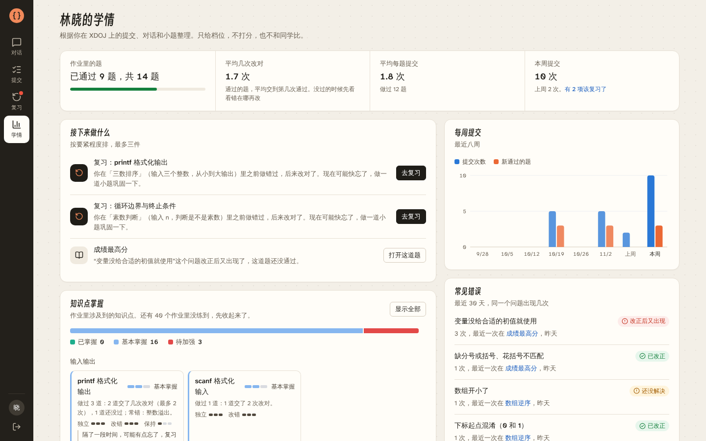

# 程序设计智能体

给上 C 语言程序设计课（以及之后的数据结构课）的学生和任课教师用。系统只读地同步 XDOJ 上的练习提交，自动分析没通过的提交错在哪、涉及哪个技能；学生可以就某次提交或某个概念提问；按每个学生自己的情况出很短的代码小题，检验是否真的掌握；卡过的地方在快忘的时候安排复习；给学生和教师看学情。只面向平时练习和答疑，不接考试。

设计依据是《给 ClaudeCode 的总说明》及其附件（对话工作流与标签库、XDOJ 同步程序开发说明、设计规范 A 工作台）。这些原始文档没有放进这个公开仓库。

## 界面

学生端按 [界面改造方案](docs/design/界面改造方案/界面改造方案.md) 分成三个栏目：知识问答、作业引导、复习提升，“我的学情”在左下角（一级导航“提交”撤掉了，全部提交记录从学情进）。做到哪了、和方案哪里不一样见 [界面改造落实记录](docs/界面改造落实记录.md)。作业引导的左栏分层导航和主动提问见 [作业分层导航与主动提问](docs/作业分层导航与主动提问.md)。

登录首页（C 语言 / 数据结构滑动切换、跟着光标的立体场景、学生和老师一个入口）和全站配色、字体（C 语言暖色的纸、数据结构冷色的纸；标题得意黑、西文 Atkinson Hyperlegible Next、代码 Maple Mono）见 [首页课程切换与统一登录](docs/首页课程切换与统一登录.md)。605px 右栏、代码引用上下文和 PDF 样例边界修复见 [首页视觉与代码上下文修复](docs/首页视觉与代码上下文修复.md)。直接对话与主动复习见 [对话与主动复习修复](docs/对话与主动复习修复.md)。此前桌面与模型证据改动见 [桌面改进交付记录](docs/桌面改进交付记录.md)。教学指导可编辑 `backend/app/chat/prompts/tutoring.md`，或用 `CHAT_TEACHING_PROMPT_FILE` 指定自定义文件。贡献署名见 [CONTRIBUTORS.md](CONTRIBUTORS.md)。

| C 语言 | 数据结构 |
|---|---|
|  |  |

| 学生：对话 | 教师：知识图谱 |
|---|---|
|  |  |
| **学生：学情** | **教师：总览** |
|  |  |

全部截图（四个宽度）在 [docs/design/screenshots/](docs/design/screenshots/)，设计上和规范不一样的地方见 [docs/design/审查记录.md](docs/design/审查记录.md)。

## 现在做到哪了

| 部分 | 状态 |
|---|---|
| 数据表、固定编码表 | 已完成。C 语言 65 个知识点、128 条技能；数据结构 30 个知识点、56 条技能；两门课之间 28 条跨课程先修边 |
| XDOJ 服务器 | C 语言的地址 `http://47.92.139.74/xdoj-ssm` 写进了代码（出处是《总说明》3.1）；数据结构的服务器地址不同，给出后填进 `.env` 的 `XDOJ_DS_URL`。别的课用 C 语言的地址会被拒绝 |
| XDOJ 连接器和同步（白名单、限速、轮询、详情、回读、回填、证据 JSON） | 已完成，用假 XDOJ 测过，**没有连过真实服务器**（这个开发环境连不上那个地址） |
| 标注（规则 + 大模型）、题目标注、参考解验证 | 已完成，大模型路径只用桩测过 |
| 对话工作流（8 步、规则表、回复校验、卡点递进） | 已完成；没配大模型时走规则和固定模板 |
| 小题 | 按学生的情况出题：优先改学生自己通过的代码，其次让大模型出，再次用模板换名字，最后才用题库；每道题都在沙箱里验证过 |
| 掌握程度 | v2（默认）：可靠性加权（雷同的通过打折）、个人化的遗忘、知识图先验、80% 区间；v1 保留作对照 |
| 全部自动 | 名单和作业每两小时自动同步（新学生、新作业、名单外的学号登录时马上同步），新提交几十秒内自动到；对话回合自动结束、自动评估、跨课程联系自动补充和检验；学生端、教师端的页面自己刷新。没有任何需要点的“同步”“评估”按钮 |
| 跨课程（数据结构这边） | 带类型的跨课程联系（先修、被用于、是其中一部分、相似），智能体每天夜里自动补充；每条联系用数据检验；数据结构的估计是 C 基础和自己表现的可解释融合（η）；C 基础预警。C 语言那边不出现这些 |
| 多维掌握画像、智能体评估 | 做题、理解、独立、保持、自知、先修六个维度，按数据学权重融合；对话结束后智能体自动按量规评“理解”，结论要引用学生原话。方法和创新点见 [docs/创新点与方法.md](docs/创新点与方法.md) |
| 复习 | 间隔重复：每一项有自己的半衰期，快忘的时候提醒，答对了间隔拉长，连对三次算巩固 |
| 学生端页面（登录、对话、提交、差异、复习、学情） | 已完成，四个宽度检查过 |
| 教师端 | 分三块，每页回答一个问题（[docs/教师端结构.md](docs/教师端结构.md)）：班级（总览、学生、学生明细、知识图谱；数据结构另有跨课程）上课用；研究（模型检验、理解评估、求助效果）论文用；数据（日志申请、数据源）。卡点按知识点看，在知识图谱的知识点详情里 |
| 日志申请 | 老师按需下载自己学生的使用记录（CSV / JSON），要写用途、留审计记录、链接 7 天失效；带学号和姓名（自己和期末成绩按学号比对），研究用的几类有卡点、求助回合、理解评估和独立作答的字段，见 [docs/研究数据与指标.md](docs/研究数据与指标.md) |
| 理解评估的检验 | 智能体评的“理解”和只看事实的规则对照（一致率、κ），以及按事实下调了多少、为什么 |
| 图模型（贝叶斯网络，只在教师端显示） | 已完成，参数是经验值，先修边是未审定的初稿 |
| 登录 | 学生和老师一个入口（学号 / 工号），首页滑动开关选 C 语言或数据结构；老师用 XDOJ 账号登录，系统核对 `userType` 是教师，自动同步他的班级和名单；学生用名单里的学号和 XDOJ 密码登录（转发给 XDOJ 核对，不保存密码）。**学生这条、统一入口的教师这条都还没有用真实账号测过** |
| 新技能和新错误自动入库 | 没做（在待确认清单里） |
| 接入数据结构的服务器 | 代码已经支持（分开登录、分开同步），地址填 `XDOJ_DS_URL` 就能用；还没有连真实的数据结构服务器 |

没做完和需要你确认的地方都列在 [docs/问题清单.md](docs/问题清单.md)。

## 运行

### 试用（Linux 机器或虚拟机）

只需要 Python 3.11 以上和 gcc。前端已经构建好放在仓库里，不用装 Node。

```bash
git clone https://github.com/Go-getter2006/Agent_C.git && cd Agent_C
./run.sh deps     # Ubuntu / Debian 上装 Python 和 gcc，只需一次（要 sudo）
./run.sh          # 第一次会自动装依赖、生成 .env 和密钥，问一次 DeepSeek 的 key；然后在后台启动，终端还给你
```

| 命令 | 做什么 |
|---|---|
| `./run.sh` | 在后台启动（网页和同步在同一个进程里） |
| `./run.sh stop` / `restart` / `status` | 停止、重启、看在不在跑 |
| `./run.sh log` | 看运行日志（Ctrl+C 只是退出看日志，程序继续跑）。日志在 `data/server.log`，每次启动时超过 20 MB 就换新文件，旧的留一份 `server.log.1` |
| `./run.sh update` | 拉最新代码、更新依赖、把数据库升到最新版本（新加的表和列自动补上，原有数据不动）、重启 |
| `./run.sh service` | 装成开机自启的系统服务（要 sudo） |
| `./run.sh demo` | 用演示数据启动（单独一个库） |
| `./run.sh fg` | 在前台运行（调试用，Ctrl+C 停止） |

端口默认 8000，可以 `PORT=8080 ./run.sh` 改。

装成系统服务以后，上面的命令照样用：`./run.sh`、`stop`、`restart`、`update`、`status` 交给系统服务去做（会要 sudo），不会另起一份抢端口；`./run.sh log` 改看系统日志（`journalctl -u agent-c`）。

然后浏览器打开 `http://这台机器的地址:8000`：

1. 学生和老师是同一个登录入口：填学号或工号、XDOJ 的密码。系统去 XDOJ 核对，XDOJ 说是教师就进教师端。
2. **老师**第一次登录后，系统自动同步他名下的班级、学生名单、作业和提交。
3. **学生**用名单里的学号和自己的 XDOJ 密码登录。名单还没同步下来的学号登录不了（XDOJ 上确有这个学生时，系统马上自动再同步一次名单）。
4. **C 语言和数据结构分开登录**。首页顶上的滑动开关选课程，两个选项一直都在；两门课是两台 XDOJ，账号密码可能不同。数据结构那台的地址填进 `.env` 的 `XDOJ_DS_URL` 以前，首页能切到数据结构，但提示还没接入、不能登录。登录哪门课就只看哪门课：C 语言里不出现数据结构；数据结构里可以看学生在 C 语言相关知识点上掌握得怎么样，但不出现 C 语言的答题记录。

只想看看界面、不连 XDOJ：`./run.sh demo`。学生学号 `2500000001`，教师工号 `demo-teacher`（同一个登录框），密码都是 `.env` 里的 `DEV_LOGIN_PASSWORD`（第一次运行时设成 `demo`）。

为什么是 Linux：小题的“运行检查”要编译、运行学生改的代码，沙箱用的是 Linux 才有的限制。

改了前端代码以后，要在装了 Node 的机器上 `cd frontend && npm run build`，把 `frontend/dist` 一起提交。

### 正式部署（公网）

服务器上只装 Docker，不用装 Python 和 Node：

```bash
git clone https://github.com/Go-getter2006/Agent_C.git && cd Agent_C
cp .env.example .env    # 填 SECRET_KEY、POSTGRES_PASSWORD、DEEPSEEK_API_KEY，要 HTTPS 再填 DOMAIN
docker compose --profile https up -d --build
```

会起五个容器：PostgreSQL、网页、后台同步、沙箱（没有网络、只读、去掉全部特权）、Caddy（自动申请 HTTPS 证书）。已经有学校网关或 nginx 做 HTTPS 的，去掉 `--profile https`，把网关转发到本机 8000 端口。更新：`git pull && docker compose up -d --build`。这份 compose 在开发环境里没有实际启动过，第一次部署请留意。

### 核对 XDOJ 的接口

能访问 XDOJ 的人（或另一个 AI）可以按 [docs/XDOJ接口核对清单.md](docs/XDOJ接口核对清单.md) 发请求，把结果发回来；也可以在这台机器上用命令行：

```bash
cd backend && . .venv/bin/activate
# .env 里填 XDOJ_USER、XDOJ_PASS（地址不用填，就是 C 语言那台）
python -m app.cli login-test          # 只测登录
python -m app.cli xdoj-probe          # 核对接口字段名（只打印字段名和类型）
```

对 XDOJ 只读：客户端里写死了允许访问的十几个查询接口，其他路径一律不发；所有请求排队，两次请求至少间隔 0.2 秒。名单接口带回的学生密码、令牌、登录 IP 在内存里就丢掉，不进库也不进日志。

## 测试

```bash
cd backend
python -m pytest tests -q                                   # 内存 SQLite
TEST_DATABASE_URL=postgresql+psycopg://用户:密码@主机/库 python -m pytest tests -q   # 同一套测试跑在 PostgreSQL 上
```

## 目录

```
backend/
  app/
    config.py        全部配置和可调参数（权重、阈值都带版本号）
    models.py        数据表
    taxonomy/        固定编码表：知识点、技能、错误类型、先修边初稿、枚举
    xdoj/            连接器、同步、主循环、证据 JSON、假 XDOJ
    labeling/        错误标注（规则优先）、题目标注
    llm.py           大模型网关
    sandbox/         编译运行小题代码
    chat/            对话工作流：分析、取证、规则表、生成、校验
    servers.py       已知的 XDOJ 服务器（C 语言的地址写在这里）
    quiz.py quizbank.py   小题的作答和判分、题库
    quizgen.py       按学生情况出小题
    review.py        复习（间隔重复）
    similarity.py    通过代码的雷同检查
    mastery.py       掌握程度 v1、v2
    graphmodel.py    图模型（只在教师端）
    progress.py      学生学情页
    logs.py          教师的日志申请
    catalog.py       学生可见范围
    web/             接口：登录、学生端、教师端
    demo/            演示数据
    cli.py           命令行
  alembic/           数据库迁移
  tests/
frontend/            React + TypeScript + Vite
  src/styles/tokens.css   设计令牌
  src/components/    外壳、对话、小题、图表、知识图谱
  src/pages/         学生端页面；teacher/ 是教师端
docs/                技术方案、问题清单、怎么验证、设计审查记录
```
