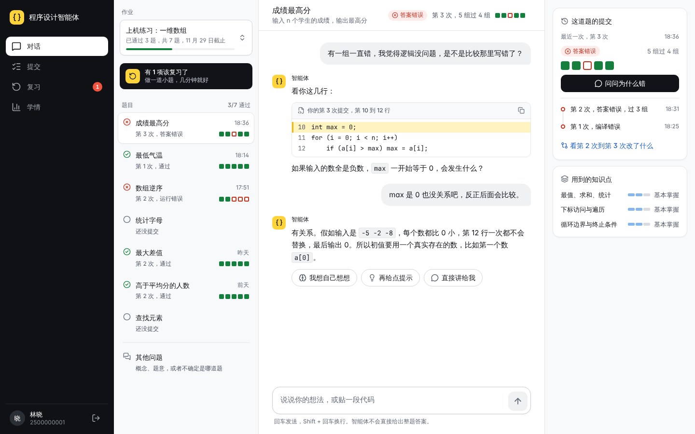
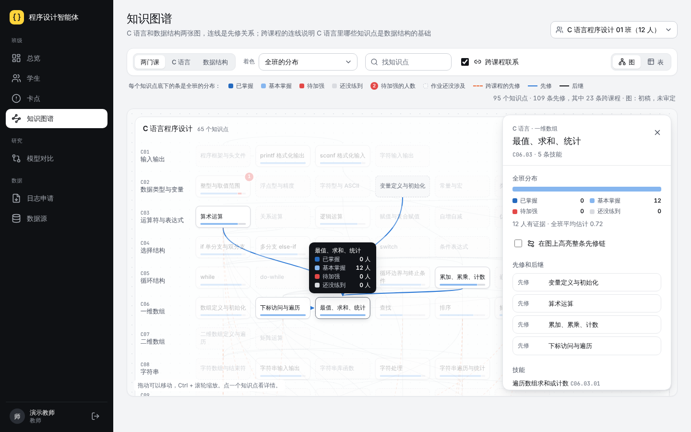
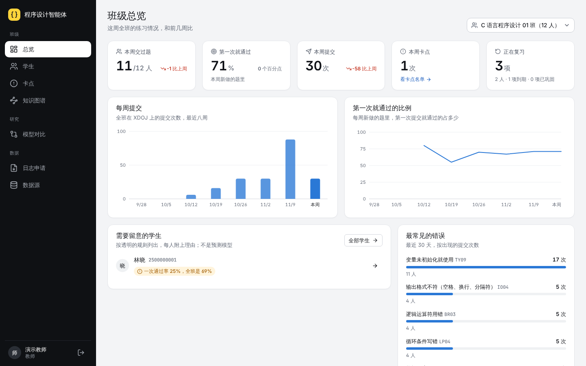

# 程序设计智能体

给上 C 语言程序设计课（以及之后的数据结构课）的学生和任课教师用。系统只读地同步 XDOJ 上的练习提交，自动分析没通过的提交错在哪、涉及哪个技能；学生可以就某次提交或某个概念提问；按每个学生自己的情况出很短的代码小题，检验是否真的掌握；卡过的地方在快忘的时候安排复习；给学生和教师看学情。只面向平时练习和答疑，不接考试。

设计依据是《给 ClaudeCode 的总说明》及其附件（对话工作流与标签库、XDOJ 同步程序开发说明、设计规范 A 工作台）。这些原始文档没有放进这个公开仓库。

## 界面

| 学生：对话 | 教师：知识图谱 |
|---|---|
|  |  |
| **学生：学情** | **教师：总览** |
|  |  |

全部截图（四个宽度）在 [docs/design/screenshots/](docs/design/screenshots/)，设计上和规范不一样的地方见 [docs/design/审查记录.md](docs/design/审查记录.md)。

## 现在做到哪了

| 部分 | 状态 |
|---|---|
| 数据表、固定编码表 | 已完成。C 语言 65 个知识点、128 条技能；数据结构 30 个知识点、56 条技能；两门课之间 28 条跨课程先修边 |
| XDOJ 服务器 | C 语言的地址 `http://47.92.139.74/xdoj-ssm` 写进了代码（出处是《总说明》3.1）；数据结构的服务器地址不同，还没给出。别的课用 C 语言的地址会被拒绝 |
| XDOJ 连接器和同步（白名单、限速、轮询、详情、回读、回填、证据 JSON） | 已完成，用假 XDOJ 测过，**没有连过真实服务器**（这个开发环境连不上那个地址） |
| 标注（规则 + 大模型）、题目标注、参考解验证 | 已完成，大模型路径只用桩测过 |
| 对话工作流（8 步、规则表、回复校验、卡点递进） | 已完成；没配大模型时走规则和固定模板 |
| 小题 | 按学生的情况出题：优先改学生自己通过的代码，其次让大模型出，再次用模板换名字，最后才用题库；每道题都在沙箱里验证过 |
| 掌握程度 | v2（默认）：可靠性加权（雷同的通过打折）、个人化的遗忘、知识图先验、80% 区间；v1 保留作对照 |
| 复习 | 间隔重复：每一项有自己的半衰期，快忘的时候提醒，答对了间隔拉长，连对三次算巩固 |
| 学生端页面（登录、对话、提交、差异、复习、学情） | 已完成，四个宽度检查过 |
| 教师端（总览、学生、学生明细、卡点、知识图谱、模型对比、日志申请、数据源） | 已完成 |
| 日志申请 | 老师按需下载自己学生的使用记录（CSV / JSON），要写用途、留审计记录、链接 7 天失效 |
| 图模型（贝叶斯网络，只在教师端显示） | 已完成，参数是经验值，先修边是未审定的初稿 |
| 学生用 XDOJ 账号登录、新技能和新错误自动入库、接入数据结构的服务器 | 没做（在待确认清单里） |

没做完和需要你确认的地方都列在 [docs/问题清单.md](docs/问题清单.md)。

## 在自己电脑上跑起来（演示数据）

需要 Python 3.11 以上、Node 20 以上；小题的“运行检查”需要 gcc（只在 Linux 上用过）。

```bash
# 1 后端
cd backend
python -m venv .venv && . .venv/bin/activate        # Windows：.venv\Scripts\activate
pip install -r requirements-dev.txt
cp ../.env.example ../.env                           # 然后编辑 .env，至少填 DEV_LOGIN_PASSWORD

# 2 前端（构建一次，由后端托管）
cd ../frontend && npm install && npm run build

# 3 入演示数据，启动
cd ../backend
python -m app.cli demo-seed
python -m app.cli serve
```

浏览器打开 <http://127.0.0.1:8000>。演示数据是虚构的一个班：

- 学生：学号 `2500000001`，密码是 `.env` 里的 `DEV_LOGIN_PASSWORD`；
- 教师：在登录页选“教师”，账号 `demo-teacher`，密码同上。

演示数据不是直接写进表里的：程序先搭一台假的 XDOJ，再让真实的同步程序去同步它，然后按时间顺序跑标注、学情和几段对话。所以页面上看到的每一项都是真实流程产生的。

改前端时可以另开一个终端运行 `npm run dev`（<http://127.0.0.1:5173>，接口会转发到 8000 端口）。

## 接真实的 XDOJ（试点）

先看 [docs/怎么验证.md](docs/怎么验证.md) 第 2 节，按顺序做：

```bash
# .env 里填 XDOJ_BASE_URL、XDOJ_USER、XDOJ_PASS、SECRET_KEY
python -m app.cli login-test          # 只测登录
python -m app.cli xdoj-probe          # 核对接口字段名（只打印字段名和类型）
python -m app.cli sync-meta --max-requests 200
python -m app.cli backfill --max-requests 2000
python -m app.cli daemon              # 常驻主循环
python -m app.cli stats
```

对 XDOJ 只读：客户端里写死了允许访问的十几个查询接口，其他路径一律不发；所有请求排队，两次请求至少间隔 0.5 秒。名单接口带回的学生密码、令牌、登录 IP 在内存里就丢掉，不进库也不进日志。

## 部署

`docker compose up -d --build` 会起四个容器：PostgreSQL、网页和接口、常驻主循环、沙箱。沙箱容器没有网络、根文件系统只读、去掉了全部特权，只通过共享卷上的套接字收请求。HTTPS 由前面的反向代理负责。部署前在 `.env` 里填 `SECRET_KEY`、`POSTGRES_PASSWORD`。这份 compose 文件在开发环境里没有实际启动过，第一次部署时请留意。

## 测试

```bash
cd backend
python -m pytest tests -q                                   # 内存 SQLite
TEST_DATABASE_URL=postgresql+psycopg://用户:密码@主机/库 python -m pytest tests -q   # 同一套测试跑在 PostgreSQL 上
```

## 目录

```
backend/
  app/
    config.py        全部配置和可调参数（权重、阈值都带版本号）
    models.py        数据表
    taxonomy/        固定编码表：知识点、技能、错误类型、先修边初稿、枚举
    xdoj/            连接器、同步、主循环、证据 JSON、假 XDOJ
    labeling/        错误标注（规则优先）、题目标注
    llm.py           大模型网关
    sandbox/         编译运行小题代码
    chat/            对话工作流：分析、取证、规则表、生成、校验
    servers.py       已知的 XDOJ 服务器（C 语言的地址写在这里）
    quiz.py quizbank.py   小题的作答和判分、题库
    quizgen.py       按学生情况出小题
    review.py        复习（间隔重复）
    similarity.py    通过代码的雷同检查
    mastery.py       掌握程度 v1、v2
    graphmodel.py    图模型（只在教师端）
    progress.py      学生学情页
    logs.py          教师的日志申请
    catalog.py       学生可见范围
    web/             接口：登录、学生端、教师端
    demo/            演示数据
    cli.py           命令行
  alembic/           数据库迁移
  tests/
frontend/            React + TypeScript + Vite
  src/styles/tokens.css   设计令牌
  src/components/    外壳、对话、小题、图表、知识图谱
  src/pages/         学生端页面；teacher/ 是教师端
docs/                技术方案、问题清单、怎么验证、设计审查记录
```
