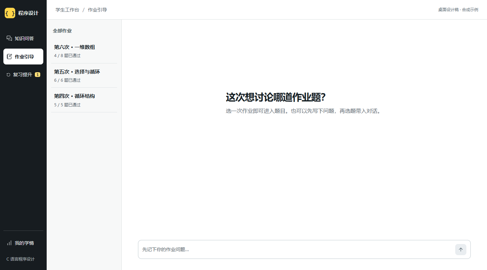
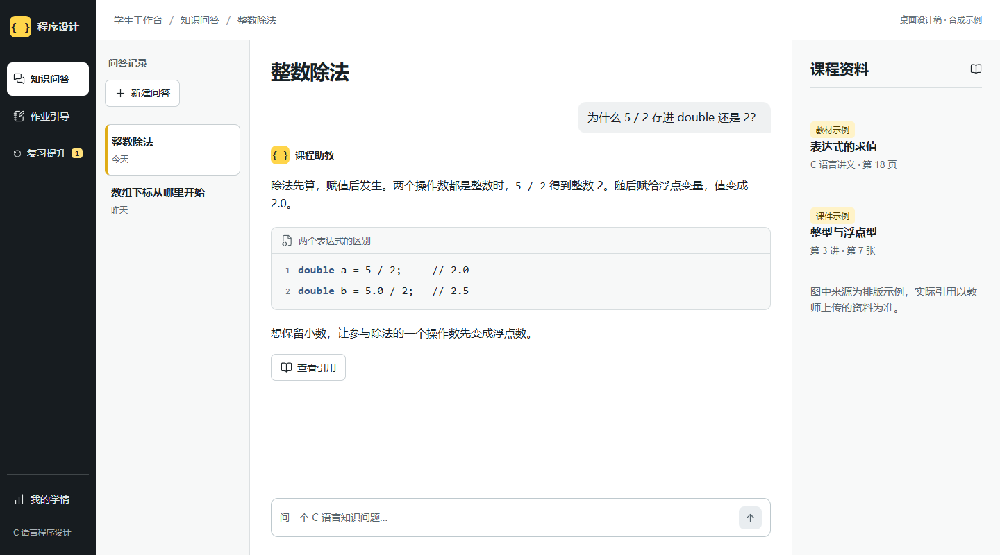
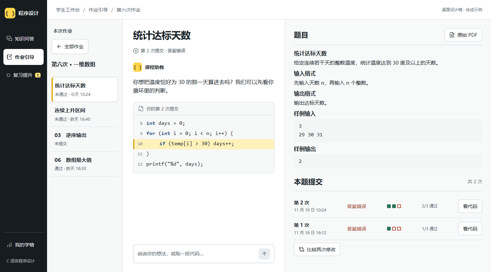
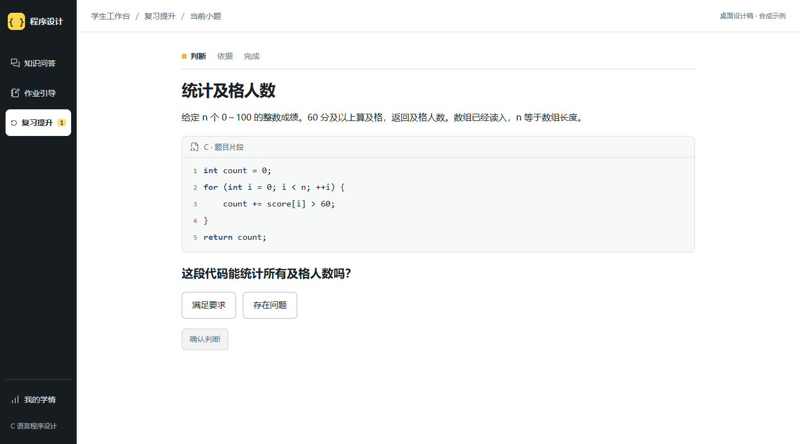
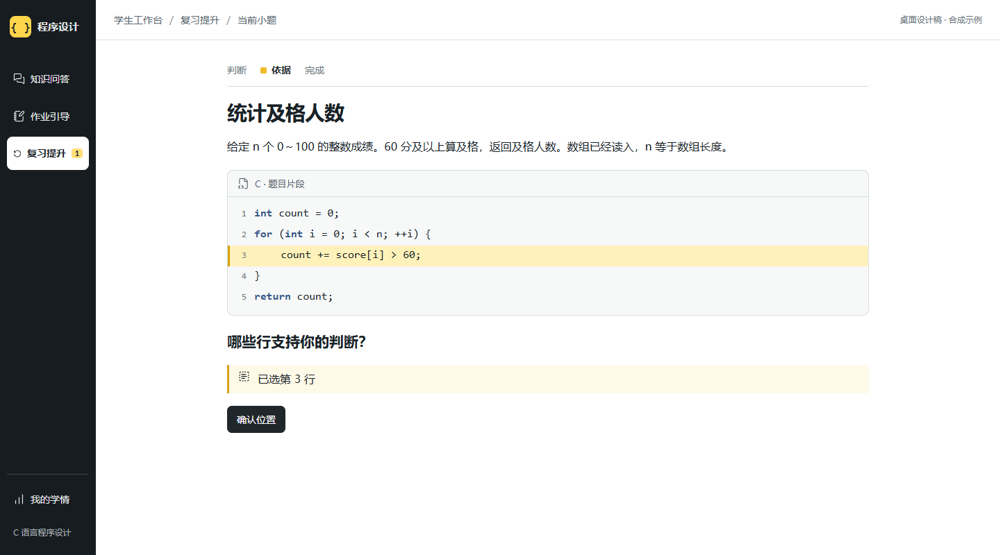
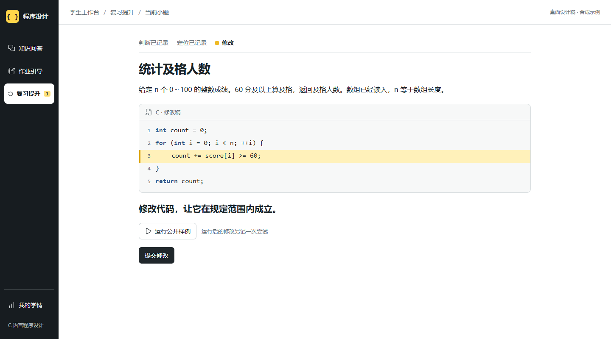
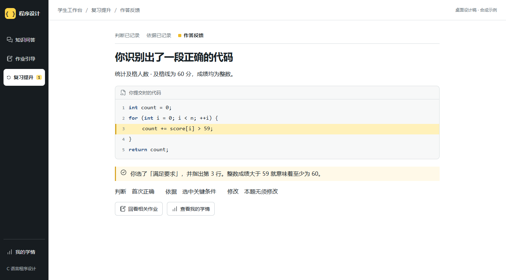
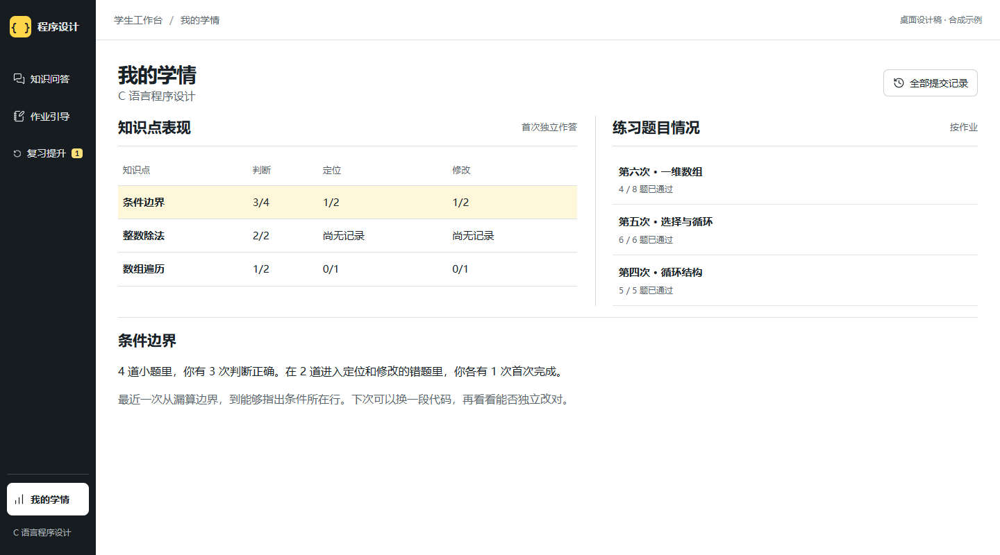
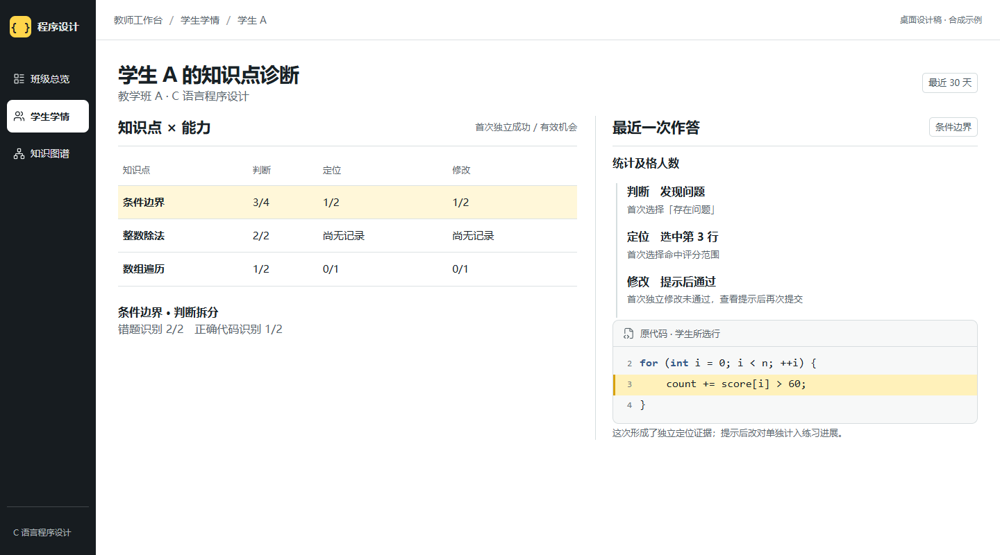

# 程序设计智能体 · 学生端界面改造方案

**评审稿 · 2026 年 11 月 19 日 · 桌面端**  
面向 C 语言课程的学生、任课教师与研究人员。本文依据项目本地版本 `8f30812` 编写。图 1～9 为 1440 × 800 桌面设计稿，使用虚构练习和合成作答。文中的路由、统计口径和实施步骤均有现状或拟议标识。

## 1. 首页怎么进，三个栏目怎么分

**主导航按学生的来意排列为「知识问答」「作业引导」「复习提升」。首次登录落在作业引导。再次登录恢复上次有权限访问的位置。「我的学情」放在左下角。** 撤掉一级导航「提交」，保留本题记录和跨题历史两个入口。沿用现有登录视觉，首页在本文指登录后的学习工作台。

| 学生此刻的想法 | 应该进入 | 第一眼看到什么 | 做完后去哪里 |
| --- | --- | --- | --- |
| “整数除法怎么算？老师上课讲过吗？” | 知识问答 | 最近的知识对话、输入框。命中课程资料时有可打开的出处 | 继续问、读资料，或回原作业 |
| “我这份代码为什么没过？” | 作业引导 | 初次看到全部作业。回访可直接恢复题目、对话和草稿 | 查看本题提交、对比版本，继续讨论 |
| “离开原题，我还能看懂、找到问题、改对吗？” | 复习提升 | 一道已备好的短题。中途离开则恢复原作答 | 看本次反馈、回看原作业，或稍后继续 |
| “这个知识点我究竟卡在哪一步？” | 我的学情 | 各知识点的判断、定位、修改记录，以及作业进度 | 点开相关小题、作业或全部提交记录 |

**图 1 · 首次进入作业引导。** 作业标题就是左栏的第一层。点击一次进入本次题目。已有草稿可带入选中的题。中心区只承担选题和输入，不再加一套作业看板。

**页面切换约定。** 切栏时保留各自的最近位置。学生在某题写了一半，去知识问答查整除，再回来，应看到同一道题、同一段草稿和原来的滚动位置。知识问答与作业对话分别保存。草稿和恢复位置按账户、课程和对话区分。退出登录后清除本机该会话草稿。外部深链接优先于上次位置。已失权或已删除的目标退回当前课程的栏目首页。初次没有作业时，可直接进入知识问答。

## 2. 在知识问答里查概念、读教材原页

**图 2 · 学生问“为什么 5 / 2 存进 double 还是 2？”** 中间先解释求值顺序，再给两行可对照的代码。右侧是该回答引用的材料。图中的书名与页码仅用于演示排版，待教师上传后才显示真实出处。

- **左侧是问答记录。** 默认恢复上次知识问答，可新建主题。已有综合对话保留原始时间和内容。有历史小题的消息继续可读。多主题列表属于需新增的能力。
- **中间是回答。** 术语、语法、标准库用法等事实问题先直接回答。理解困难时给一个短例子。学生明确选择「结合当前题」后才附带题名和相关代码，可移除。知识问题与原题无关时，回答到这里即可。
- **资料来源随回答出现。** 命中教师上传的讲义、教材或 PPT 时，在对应段落下显示来源，点击后右侧打开文档、页码或幻灯片。只有一个来源也可直接打开。尚未上传、检索无匹配、页码无法核实时，正常回答通用知识，并省去缺少依据的引用。资料区只在有内容时占宽。
- **留下什么记录。** 可以保留问答和来源版本，方便教师了解学生问过什么。一次查教材、一句“我懂了”，均不产生三维诊断中的成功作答。

## 3. 在作业引导里并排查看对话、题面和提交

**图 3 · 进入作业后自动选中最近未通过题。** 右侧原始 PDF 紧挨题面标题，两个提交版本直接列在题面下。学生可以边看自己的代码边回答助教。

| 区域 | 默认行为 | 关键细节 |
| --- | --- | --- |
| 左栏 · 全部作业 → 本次题目 | 点作业后仅左栏向左滑入，自动选排序第一题 | 优先未通过题，按最近提交倒序。未提交题按题号升序。评测中或结果未知单独标记。已通过放最后，按最近提交倒序。作业列表和题目列表各自可滚动 |
| 左上返回 | 「← 全部作业」目标高度至少 44 px | 返回只退左栏层级，保留当前题的对话、右栏与草稿。键盘操作恢复到原作业按钮 |
| 中间 · 题目对话 | 已确认的失败提交由智能体主动问一句具体问题 | 同一次失败不重复发。学生已在讨论时继续原对话。引用学生代码显示上下文、真实行号和重点行。有需要可给小段示例，输入框下不放限制性口号 |
| 右栏 · 题面与 PDF | 宽桌面保留现有 605 px 阅读空间，题面和提交可纵向滚动 | 输入格式、输出格式、样例输入、样例输出、样例说明分别显示。图片随题面出现。文字整理失败可打开原始 PDF。快速切题时，用加载状态标明内容归属，避免把旧题面认成新题面 |
| 右栏 · 本题提交 | 最近在上，所有提交直接列出。每行显示次数、时间、结果、方块和通过组数 | 点击「看代码」阅读该版本，两个版本之间可直接比较。方块同时配文字计数。编译失败或测试点详情未取得时写明状态。超过一屏的记录在右栏滚动 |

**三个容易混淆的按钮，分别处理。**

| 现有或拟议操作 | 去留 | 学生如何找到 |
| --- | --- | --- |
| 一级导航「提交」 | 撤掉导航项，保留数据与旧链接 | 想看这道题，直接看作业右栏。想找上周交过的另一道题，从「我的学情 → 全部提交记录」进入 |
| 本题「问问为什么错」「展开之前提交」 | 移除这两个中间步骤 | 助教针对新失败主动询问。每次提交自带对应的测试点摘要。代码和差异按需打开 |
| 复习小题的交卷按钮 | 保留并写明动作 | 「确认判断」「确认位置／确认依据」「提交修改」只记录平台内的小题作答。XDOJ 继续只读 |

从跨题记录返回题目对话时，携带所选的提交版本。如果选的是第一次失败，就引用第一次的代码。跨题记录默认按最近提交倒序，保留原有题目、作业筛选和差异入口。

## 4. 在复习提升里独立判断、定位和修改

智能体从近期错误、改过几次才通过的知识点中优先选题，偶尔抽查已独立通过的知识点。后台提前准备、校验，题目可用后才增加导航数量。学生进入栏目即见题，中途离开可继续同一题。当天没有可做题时显示最近一次反馈或下次安排。生成失败时后台退避重试，已有可用题先展示。到期数、已生成数与已完成数分开计算。

### 4.1 先判断，界面本身不泄题

**图 4 · 同一份题干可以配正确代码，也可以配错误代码。** 确认前可以改选。第一次选择没有红绿提示、错误行高亮、原聊天或教材引用。「满足要求」和「存在问题」两个选项具有相同的视觉权重。提交后锁定首次判断。

每题围绕一个可说明的要求，例如“成绩为整数，60 分及以上及格”。系统用学生过往的错误选择**考哪个知识点**。正式测量题在同一知识点、相近难度内随机发放经验证的正误版本，目标按题组接近各半，允许个人短序列自然波动。学生连续答错后可安排辅导题。正式测量题的正误分配独立于学生的自信程度。同一学生同一轮只收到一版。

### 4.2 再选位置，最后修改

**图 5 · 学生自己点击行号后，第 3 行才出现黄色背景。** 学生先提交位置，系统绑定到该题代码版本。若认为代码正确，就选支撑判断的关键行，按钮显示「确认依据」。这一阶段不公布正误，学生可用键盘选行和确认。

**图 6 · 学生认为有问题时，打开可编辑代码。** 图中已把条件改为 `>= 60`，尚待提交。修改后仍可查看原稿。实际提交的代码、首次结果、后续尝试和提示分别保存。服务端按题目的输入范围和校验用例判分，接受行为等价的修改。

- 选择「存在问题」的学生沿“选位置 → 修改或保留原样”继续，包括误判了正确代码的情况。这样界面不会通过提前结束来透露正确答案。修正自己原先的判断算自我纠正，首次记录保留。
- 选择「满足要求」的学生提交判断依据后进入反馈。若实际上漏判了错误，可在讲解后练习定位和修改，这些记录注明“已获反馈”。若希望测量这名学生独立修改的能力，另出一道未见过的题。
- 提交前运行公开样例、看提示、读过讲解后再改，都保留具体顺序。教师能区分“第一稿直接通过”“自行运行后改对”“提示后改对”。系统错误、沙箱超时或请求失败可重试，沿用原作答编号，等待期间不计为学生错误。
- 没把握可以记录信心。放在首次确认附近、给同样的选项。信心用于分析自我判断与实际表现的差距，不额外弹出一整屏，也不把自信直接折算成加分。

**图 7 · 正确代码也要有完整的结束页。** 对整数成绩，`> 59` 与 `>= 60` 等价。学生能认出这一点，即使一行都没改，也获得有效的判断证据。修改栏显示“本题无须修改”。反馈发布后再开放“回看相关作业”，让学生把独立尝试与原来的学习过程联系起来。

### 4.3 四种答案分别意味着什么

| 题目真实情况 | 学生首次判断 | 可观察到的表现 | 三维数据如何处理 |
| --- | --- | --- | --- |
| 有错 | 存在问题 | 识别出错误，可继续选行和改代码 | 给判断记一次成功。独立定位、独立修改各按实际结果记 |
| 有错 | 满足要求 | 漏判，也可能解释了错误依据 | 给判断记一次失败。定位和修改标“未进入”。讲解后的尝试单列 |
| 正确 | 满足要求 | 能识别正确代码，还可指出关键依据 | 给判断记一次成功。依据留作解释。错误定位和修改均“不适用” |
| 正确 | 存在问题 | 误报，可能把原本正确的写法改坏 | 给判断记一次失败。记录误指位置与多余修改，用于识别误解。与修复真实错误的成功率分开 |

这四条路径适用于新设计的诊断题。旧系统已经保存判断结果和最终改动行，但没有独立的“先选行”动作。历史记录标为“旧版未测定位”，不能用后来改过哪行填补首次定位。

## 5. 学生和教师怎样读同一份作答记录

**图 8 · 我的学情。** 左边看知识点，右边看作业练习，两侧顶端和底端对齐。内容较长的区域内部滚动。学生点“条件边界”就能读到一句基于实际作答的说明。右上角「全部提交记录」接回原来的历史入口。

**图 9 · 教师从一个数追到一次作答。** 左边可见“条件边界”的判断 3/4、定位 1/2、修改 1/2。右边展开最近一次真实动作。该次学生独立发现并定位错误，第一次没改对，提示后才通过。教师可以针对修改策略安排练习，不必让学生从头重学什么是边界。

| 维度 | 建议主指标 | 教师点开后看到 |
| --- | --- | --- |
| 判断 | 首次独立判断正确数 / 已提交首次独立判断的题数 | 错题识别与正确代码识别分别列分子、分母。例如 2/2 和 1/2 能说明这名学生更常把正确代码判错 |
| 定位 | 首次独立选中有效错误位置数 / 真实错题中已提交首次独立选行的次数 | 原代码、学生所选行和预先审核的有效位置。首版每道题考一个错误，可允许一行或一段连续行。全选代码不能算命中 |
| 修改 | 第一稿未经提示、未经运行反馈即通过数 / 在真实错题中提交过此类第一稿的次数 | 原稿、第一稿、运行结果、修改差异及后来在哪次帮助后通过。多种有效改法均可得分 |

教师视图另列**应答机会、进入该步、独立提交、提示后完成、跳过／放弃**的数量。定位和修改的分母会受先前判断影响。例如 1/2 只描述实际完成该步的两次，不能读作对所有题的能力估计。若论文需要比较全班学生，可增加统一的独立任务。定位任务给每个人一段明确含错的新代码，修改任务则给每个人相同的已定位错误。分别标记题型，与自然分支的结果分开分析。

**评分建议。** 学生看到单题反馈和累计次数，教师可看各维度成功率与机会数。无作答显示“尚无记录”，仅一两次证据显示样本数。先别给三列硬配权重。现有掌握分已接收小题结果。第一版保留该估计，新增三维明细只用于解释。将来若要合成，每次作答只进入一次同版本评分模型。用教师审核、未参与估分的延迟共同题检验预测表现，再定权重。论文应能从去标识记录复算这些数字，并区分描述学生表现和验证复习干预效果。

**教师知识图谱沿用同一组数据。** 在现有知识点节点的详情内增加判断、定位、修改三行以及“查看作答依据”。节点颜色继续表达原有掌握档位。先修关系推断与学生实际作答分别标明。教师也可从学生明细表进入同样的证据视图。教师左栏保持紧凑，白底选中项使用深色文字。操作后保留所选学生、课程、时间范围和知识点。

## 6. 实现边界与验收

### 从现有项目迁移

| 位置 | 当前可复用的内容 | 建议改动 |
| --- | --- | --- |
| `App.tsx`、`Shell.tsx` | 学生有 `/chat`、`/chat/:key`、`/review`、`/submissions`、`/progress`，教师独立路由 | 新增知识问答与作业引导的独立入口。旧 `/chat/general` 指向原综合对话，旧题目深链接连同提交及差异参数继续可达。`/submissions` 保留地址，入口迁至学情 |
| `Workbench.tsx`、`HomeworkNavigator.tsx`、`Thread.tsx`、`Lists.tsx` | 两级作业导航、题目排序、主动问句、右栏题面和提交 | 拆开知识对话与题目对话的上下文。保留左栏动画、取消过期选题请求、按题与版本恢复草稿。旧综合对话含规范化小题块时保留历史查阅 |
| `Review.tsx`、`Quiz.tsx` 与后端 `review.py` | 已有小题、间隔安排与对话内邀约 | 复习页成为实际作答入口。复用未完成作答。旧聊天可显示历史题或跳转继续同一作答。已有真正就绪的题优先供应。“到期”与“已就绪”各有状态 |
| `quizgen.py`、`quiz.py`、`models.py` | 正误题、判断、改动行、运行、信心、结果已有记录。当前近 10 题正确代码占比的配置区间为 40%～50% | 给正式测量题单列正误分配策略。新增题目版本、首次选行、首次修改、帮助事件及发生顺序。题面和参考答案先验证，无法校验的题不进待做数 |
| `mastery.py`、`Progress.tsx`、教师 `StudentDetail.tsx` 和 `KnowledgeMap.tsx` | 已有掌握度估计、学生明细、知识图谱 | 新增可复算的三维统计，显示机会数和缺失原因。点击统计单元格查依据。旧记录和新协议按版本筛选 |
| 课程资料 | 有作业题面 PDF 阅读能力。课本和 PPT 待上传 | 为教材单独登记课程、文档版本、页码或幻灯片序号、可见权限。命中来源才显示引用。无资料也可上线知识问答 |

**建议记录的最小单元是一名学生对某一版本题目的一次作答。** 在授权范围内按课程绑定去标识学生键、作答编号、题目版本、主知识点、正误版本、作业辅导／独立复习／统一测量来源。事件按顺序记录展示、首次判断、选行、首稿、公开样例运行、提示、重试和反馈。服务端确定真实正误、评分结果和时间。前端不提前下发答案行或隐藏用例。刷新、断线、双窗口重复确认复用作答编号和已保存步骤。研究导出沿用已有用途说明、权限控制和审计，不需要把学生姓名、学号或聊天全文放进本方案。

### 桌面视觉与交互尺度

- **布局跟着任务变化。** 主导航固定。知识问答以中间文本为主，资料栏按需出现。作业页给题面和提交足够宽度。复习页撤下原题、聊天和提交侧栏，宽桌面把题干、代码和答案放在同一阅读轴线上。1280、1440 和 1920 px 分别验收，窄桌面优先收紧列表边距，允许正文换行。
- **强调色只有一个主要用途。** 延续现有深色窄导航、白色阅读面和黄色选行。深墨色 `#192126` 用于正文，浅灰 `#F7F8F8` 区分栏面，黄色 `#FFD54A` 标记当前操作，绿色 `#287455` 和砖红 `#9F4835` 搭配文字表示已公布的评测结果。未作答用中性色。教师或学生处于选中状态时，文字与背景分别指定颜色。
- **代码行要能读、能选。** 中文使用项目字体与中文系统回退，代码使用等宽字体，参考字号 15～16 px。页标题 24～30 px。固定行号宽度，长行允许横向阅读。视觉换行不改变源码行号。相邻按钮留 8～12 px，板块留 20～32 px。左栏切换约 240 ms，减少动态效果和键盘导航时直接到位。
- **交互状态要分清。** 禁用的“确认”说明还缺哪个动作。确认中显示保存状态。失败后保留选择和编辑内容。等待模型时保留能看的题面与作答。所有正确／错误方块配上文字与组数，点击行号有键盘等价操作和明显焦点。

### 分批交付与验收清单

| 批次 | 可交付结果 | 通过条件 |
| --- | --- | --- |
| ① 导航和历史迁移 | 三入口、我的学情、本题与全部提交双入口、旧链接兼容 | 空账户能直接问知识。作业切换与返回没有整页闪动。切去查知识再回来仍是原题、原提交版本和草稿。两个旧链接与差异视图均可打开 |
| ② 独立作答 | 复习入口主动备题，先判断、再给依据、按学生选择修改。正确代码有完整结束页 | 用四种正误组合逐条验收。首步界面不能猜出答案。已选行和改动行分别可查。无隐藏测试内容。生成失败不加待做，断线不重复计分 |
| ③ 学情与论文数据 | 三维分列、机会数、单次证据、授权导出 | 用已知答案的合成数据回算图 9。纳入未进入、未作答、不适用、提示后才改对、系统失败、历史缺定位六种情形。每种均有正确标签和分母 |
| ④ 课程资料 | 教材与 PPT 的可追溯引用 | 用新旧两版资料、一个无命中问题和一个无权访问的文档验证。学生点引用能到正确页。移除或失权后不再向其展示原文 |

首批可在课程资料到位前完成。第②批的沙箱出题与反馈必须在目标 Linux 环境验证。正式采集论文数据前，先锁定题目版本、提示策略和三维分母，确保学期中改界面时仍能解释先前数据。本轮提供设计文档与桌面示意图，未改产品代码、部署环境或现有成绩。

### 视觉参考与取舍

查询过指定的五个设计服务。方案采用代码工具的等宽字与阅读层级，以及可筛选表格的紧凑列对齐。教育机构宣传页和作品集用于比较首页风格。学生每天使用的学习工作台侧重读代码、继续上次作业和查记录。

- **Inspo** 找到 CodePen，借鉴代码与自然语言采用不同字体的做法，现有浅色题面继续作为长文阅读底色。[CodePen](https://codepen.io/)
- **Made Good Designs** 的 Tallyfold 是原创表格示例。借鉴数值列对齐、状态文字和筛选层级。教师诊断附加“查看本次作答”以便追溯。[UI by Made Good Designs](https://madegooddesigns.com/inspiration/ui/data-table-web-minimal-8575b7a78154)
- **Subframe** 返回 Office Commun，分行呈现材料、克制用色可借给资料栏。细小项目标签不适合中文课堂阅读。[Office Commun](https://officecommun.com/)
- **Awwwards** 返回 AACPS 教育基金会网站，属于对外传播场景。**A1 Gallery** 本轮成功返回 Zara Webb，是母婴专业服务网站。两例都未用作诊断作答流程的依据。[AACPS Education Foundation](https://fundaacps.org/) · [A1 Gallery 案例](https://www.a1.gallery/website/zara-webb)

