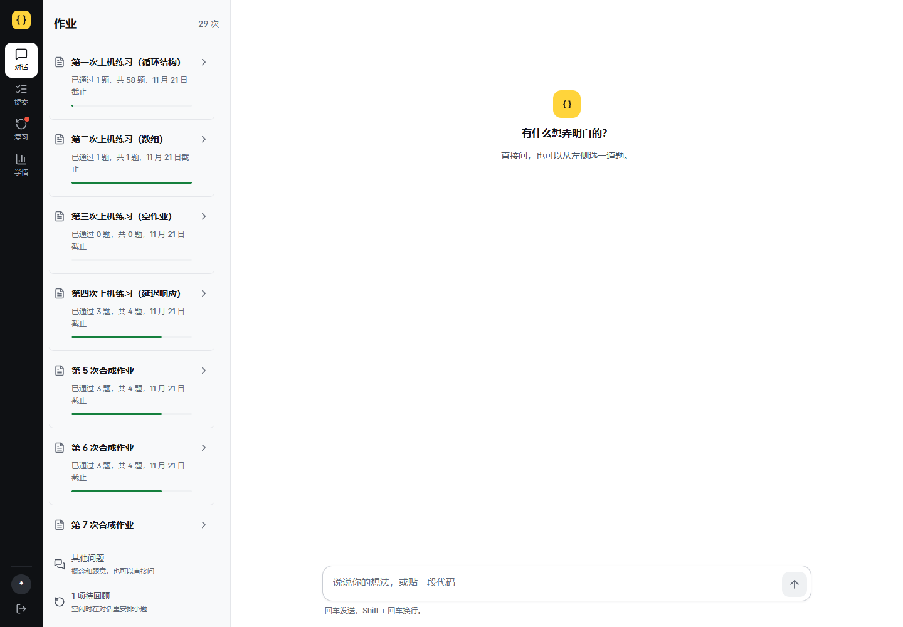
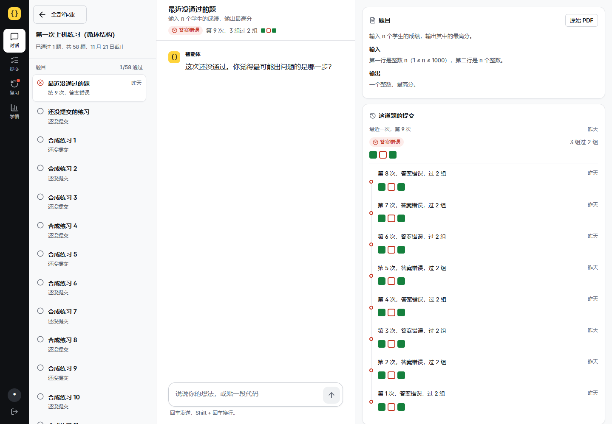

# 作业分层导航与主动提问

## 左栏交互

对话页左栏先显示全部作业，取消原有作业下拉菜单。每行保留完整作业名称、截止信息和完成进度，长列表独立滚动。

点击作业后，左栏轨道向左平移，进入该作业的题目列表。左上角提供至少 126×44px 的“全部作业”返回按钮。返回只改变左栏层级，当前对话、资料栏和正在输入的文字保持原位。

进入作业后只自动选择一次排序第一的题目；后续后台刷新不会抢走学生当前阅读的题。排序为已确认失败、未提交、评测中或结果未知、已通过；失败与通过按提交时间倒序，未提交按题目编号升序。评测中使用中性图标，不当成已确认失败。

只展示作业索引时不下载某一份隐藏的题目列表。空作业给出局部提示；加载中返回或切换其他作业会取消旧的自动选题意图，旧响应不能把页面拉回去。题目深链接仍能直接打开，并提供返回全部作业的入口。

## 主动提问

打开未通过题目时，前端自动调用 `POST /api/threads/{key}/welcome`。后端根据已保存的可靠诊断和学生源码，以现有的引导模板提问；缺少可靠定位时先询问学生的思路，不虚构错误原因。这个开场不额外调用模型，学生后续回答仍进入既有答疑与证据工作流。

开场是一条真正的智能体消息，不伪造“学生问为什么错”的聊天记录。已通过、未提交、评测中、结果未知、正在讨论或已就这次提交聊过的题不会重复插话。同一提交重复打开复用现有消息，新的失败提交经过安静间隔后可以重新发起；保留所有权和课程过滤。前端请求失败时可随正常轮询自动重试，过期请求不能覆盖新线程或学生刚发送的内容。

删除右侧“问问为什么错”按钮。提交页已有的明确提问入口仍可将学生真实问题发送到对应线程。

## 提交记录

右栏按新到旧直接显示全部提交，取消“之前的提交”折叠和六次截断。每次已取得测试点结果的提交都显示自己的绿色实心/红色空心方块及可读说明。编译错误、评测中、尚未取得结果不伪造方块；实际的输入输出仍不向学生返回。已有代码改动说明和对照功能继续可用。

学生点「就这一版问」发出消息后，气泡下方显示「引用第 N 次提交」。消息读取用服务端保存的提问记录恢复引用。直接提问时保留普通气泡。交互参考 Telegram 的目标绑定和 Discord 的随消息显示引用。当前界面沿用课程配色，仅显示一行提交次数。 [Telegram 引用](https://telegram.org/blog/reply-revolution) · [Discord 回复](https://support.discord.com/hc/en-us/articles/360057382374-Replies-FAQ)

## 参考和动画

本轮调用 Made Good Designs 和 Inspo，并查看结果截图：

- [Fernway 任务列表：UI by Made Good Designs](https://madegooddesigns.com/inspiration/ui/list-view-web-minimal-2cc9cb6336a9) 是原创 UI 样例，参考列表的主次层级与侧栏分区；搜索结果没有完整匹配 drill down，不将它描述为现成的二级导航。
- [Coursera](https://www.coursera.org/) 是 Inspo 返回的真实教育网站归档，参考课程条目可辨识性；取得的是公开首页截图，没有声称验证其登录后台交互。

最终层级与动作遵循本次需求。保留现有字体与色彩，不移植参考的品牌、照片和促销页面。轨道使用 `transform` 的 240ms CSS transition，曲线 `cubic-bezier(.25,1,.5,1)`；返回沿相反方向，连续操作可在当前位置改向。键盘操作和 `prefers-reduced-motion: reduce` 下直接切换，无整页动画、持续 will-change 或尺寸属性动画。

## 验证

- 后端完整测试 215 项通过、20 项 Linux 沙箱相关测试在 Windows 跳过。新增覆盖真实智能体消息、重复请求不重复提问、新提交再次提问、当前对话不打断、通过/评测中/未知结果/课程边界。
- 前端 10 项测试、TypeScript 与生产构建通过，更新 frontend/dist。
- Windows Edge 在 1440×1000 和 1280×1000 验证两层导航、默认选择最近错误、对话 DOM 与位置不变、返回保留草稿、长列表滚动、空作业、慢响应取消、键盘焦点、减少动画设置、九次提交和九组方块直接显示。
- 动画在 0.1 倍速下取中间帧检查方向和局部裁切，快速返回验证重新定向。没有真机触屏或手机端视觉验证。
- 本轮合并了主分支已有的“已掌握使用绿色”改动后重新构建和检查，没有回退其他贡献者的更新。

浏览器使用合成数据；没有连接虚拟机、验证线上模型或修改 XDOJ。上次复习出题失败的运行环境诊断仍需 Agent_C 自身日志，不能用这次导航测试声称已解决。

