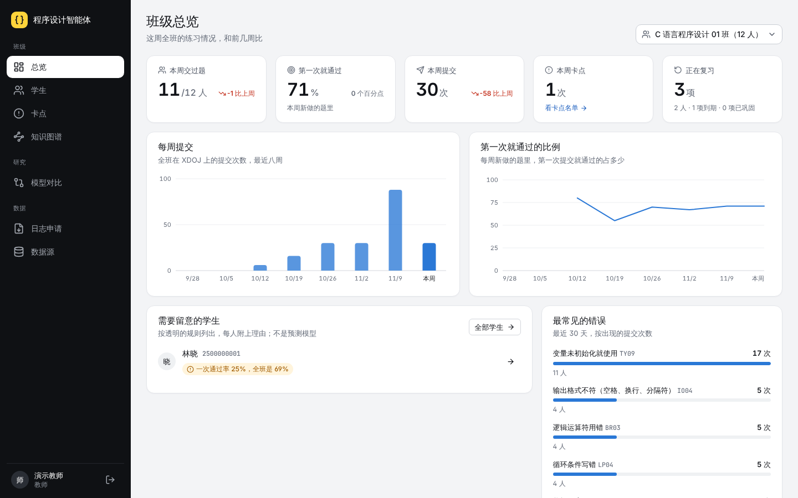
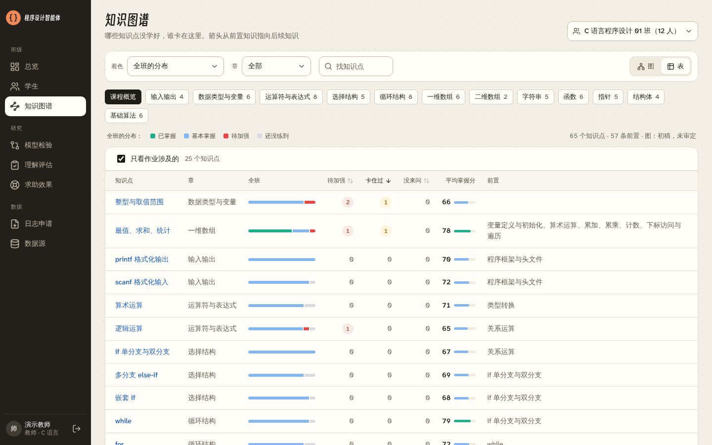
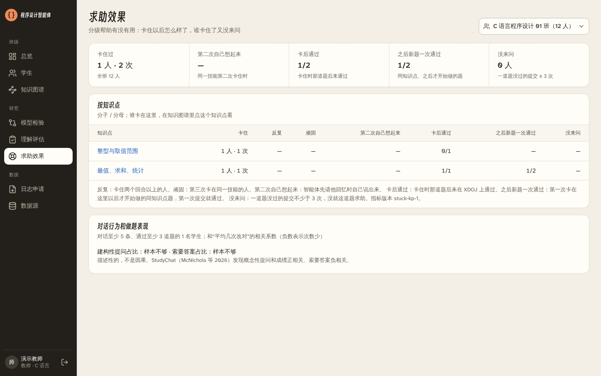

# 教师端结构

教师端分三块：**班级**（上课用）、**研究**（论文用）、**数据**（导出和同步）。每一页只回答一个问题。

**谁看得到（2026-11-21 起）**：老师只有“班级”一块。研究、数据两块和学生明细的“模型细节”页签、“申请日志”按钮只给**开发者账号**：

- 账号和密码写在 `.env` 的 `DEV_ACCOUNT`、`DEV_PASSWORD`（两项都填才能登录），和大家同一个登录框；登录时一样选 C 语言或数据结构，一个账号一个密码，两门课各看各的；
- 第一次登录时建好（角色 admin，名字“开发者”），能看这门课所有老师的班；
- 后端这几个接口用 `Depends(admin)`，老师取会得到 403；前端菜单里不出现，老师打开这几个地址回到总览。
- **几个班一起看**：开发者的班级选择可以勾几个班、可以全选（同一台服务器上的班），所有班级页和研究页都按合起来的一个班算（学生、布置的题、作业取并集，一个人在两个班里只算一次；学生列表里标出每人是哪个班）。编号写成 `c服务器-班_班_班`（后端 `ClassGroup`、`class_ids`），新加的班级页查名单、作业用 `.in_(class_ids(cls))`。
- **每一页都能导出**：开发者在班级页和研究页右上角“导出”（JSON，带指标版本；有主表的另有 CSV），是这一页（这个班或选的几个班）当下的数据，不走页面缓存（`/api/teacher/export/{页面}`）。原始记录在“日志导出”。

**总览与切班性能**：请求只读取本地同步记录并汇总，不调用大模型。全班证据、提交历史和题目标注按批读取，在一次只读数据库会话内共用；周趋势只遍历一次提交历史，统计定义不变。登录仅预计算默认班，后台最多同时重算两页，优先最近查看的页面；同班并发首次请求共用一次计算。已有结果先返回，数据变化后后台重算，浏览器继续按班级分别缓存并通过统一版本轮询更新。

两门课使用同一套班级页和刷新流程。登录课程来自凭证，不是账号的数据库列，后台重算重新读取账号后必须还原该课程；不能依赖默认值 C。数据结构额外的 C 基础预警在一次只读汇总中共用跨课程关系，避免逐个学生重复读取；后台写入或审核联系后，下个请求重新读取。`tests/test_course_pages.py` 覆盖 C / D × 教师 / 开发者的预计算、总览 / 学生列表 / 知识图谱后台刷新、切换课程隔离及无模型调用。

**多老师同步**：每位老师首次用 XDOJ 账号登录后，独立登记“服务器 × 教师账号”的数据源，并触发名下名单、作业和提交同步，不依赖 `.env` 中预填某位老师。后台按数据源加载所有启用的教师，提交进度、轮询时间、失败重试各自保存，历史分页轮转；学生活跃和指定提交触发也按数据源去重，同一批触发每个教师账号最多查一次新提交，不能只查同一服务器的第一位老师。题库仍按服务器共用。`tests/test_multiteacher_poll.py` 覆盖两门课的新教师登记与加载、同站多老师主动刷新、进度隔离、失败隔离和分页公平性。

**开发者模型管理**：在现有“模型检验”页整理模型信息，保留导航名称和 `/developer/models` 地址，只有开发者可见。分为模型概览、预测检验、参数与融合、先修诊断四个栏目。概览区分当前计分与研究对照，并说明各模型的依据和用途；公式和评分依据也集中在此。预测检验默认近两周，保留日期与版本筛选。切换栏目不卸载已加载内容，不增加请求，日期、版本及按班填写的考试时间保持；参数区标明预测样本的日期范围与当前生效参数的区别。教师和学生页面不增加算法说明，计分和后台学习流程不变。

## 一页回答一个问题

| 块 | 页面 | 回答什么 | 页面上有什么 |
|---|---|---|---|
| 班级 | 总览 | 这周班里怎么样？先关注谁，课上讲什么？ | 从上到下：三个数（本周交过题、平均几次改对、本周提交）；误区（本周 / 全部两个页签，前 6 条，全部在“误区”页）；要讲的知识点（和误区同宽、两列对齐；待加强、卡住过、没来问的人多的知识点，带最常见的错误）；需要留意的学生（分三类：一直不做题、一直卡在某处、其他，每人附理由）和作业完成情况；两张趋势图 |
| 班级 | 提交记录 | 班里最近交了什么、错在哪？ | 每一次提交，最近的在前；按学生、题目、结果筛；点一条就地展开：左边他的代码（标出程序标的出错行）和标的错误，右边每组测试点的输入、标准输出、他的输出（没过的展开、和代码块一个样子、高亮第一处不一样的行；通过的收起，他的输出和标准输出一样）。学生端看不到 |
| 班级 | 误区 | 课上要强调哪些错误点？ | 全部误区（本周 / 全部）：一种错误 × 一个技能，几个人、几次提交、还没过的几人、卡住几次、小题里没看出来的几人、出现在哪几道题、谁、他们的说法（智能体评“理解”时看出的错误想法）；可以搜、按知识点看。定义在 `app/misconceptions.py` |
| 班级 | 学生 | 每个学生做得怎么样？ | 学生列表，可以搜、可以按任何一列排序 |
| 班级 | 学生明细 | 这个学生卡在哪，怎么帮？ | 分五个页签，见下面 |
| 班级 | 知识图谱 | 哪些知识点没学好？谁卡在这里？ | 图或表（表能按待加强、卡住、没来问的人数排）。点一个知识点看：全班、卡在这里的学生、没来问的学生、每个学生、小题三维、技能、常见错误、练这个知识点的题、前置和后续 |
| 班级 | 跨课程（只在数据结构） | 要先补哪些 C 语言基础？ | C 基础预警、跨课程联系 |
| 研究 | 模型检验 | 掌握程度怎么算更准？（创新点二） | v1、v2、图模型、多维融合的 Brier 分数，消融，学到的权重；掌握分每周学的参数（这一版的系数和半衰期，和经验值比之后预测的 Brier）；根因推断，前置关系的统计 |
| 研究 | 理解评估 | 智能体评“理解”可不可信？（创新点一） | 大模型和规则的一致率；按事实下调了多少、为什么；各档、各种材料各有多少（盲评不做了） |
| 研究 | 求助效果 | 分级帮助有没有用？谁卡住了又没来问？（创新点三） | 从上到下：用了多少（用过智能体、在作业题上求助、求助时卡住过、反复没过又没来问，都是几比全班）；反复没过的题上来问的和没来问的（几题次、几人、后来通过几比几、通过前交了几次）；每次帮助之后（按帮助级别）；求助时卡住的知识点（第二次自己想起来、卡后通过、之后新题一次通过，第一行是全部）和反复没过、没来问的知识点（几人、后来通过几比几）并排；对话行为和做题表现 |
| 数据 | 日志导出 | 导出学生的使用记录 | 选班（可以全选）或填学号、时间段、哪几类，点导出就下载；带学号和姓名，研究用的几类带指标版本。不再有申请记录和用途（只有开发者用，库里照样记一条） |
| 数据 | 教师与班级 | 管理本课程的教师、班级和同步 | 每个教师账号单列一行，姓名、账号和移除操作同屏显示。展开该行可以管理名下班级。这里也显示错误库里尚未收录的常见错误。 |

教师页面使用 `/teacher`，开发者页面使用 `/developer`。教师管理在 `/developer/sources`。开发者打开旧教师地址时会转到对应的开发者页面。

移除教师会停用本课程的对应 XDOJ 数据源，并移除仅由该教师管理的班级。多个启用的数据源共享同一个班时，班级继续同步。单独移除班级会将它从所有教师的班级列表移除，并停止该班的名单和提交更新。学生若在本课程没有其他有效学籍，登录和已有会话都会失效。历史提交、对话和研究记录保留。

## 学生明细的页签

| 页签 | 有什么 |
|---|---|
| 概况 | 几个数（掌握分、已通过、平均几次改对、待加强的知识点、最近提交）；知识点表（档位、掌握分、一句话、提示）。数据结构这边另有“C 语言基础”和准备度 |
| 求助 | 卡点（哪道题、怎么解决的、之后过没过）和最近一次给的示例代码；求助回合；理解评估（附学生原话）；对话行为 |
| 小题和复习 | 判断、定位、修改三维和最近一次作答的依据；小题记录；复习安排 |
| 提交 | 提交记录（测试点、错误标注）；雷同的通过 |
| 模型细节（只给开发者） | 研究用：多维画像的数值、技能的 v2 估计和区间、v1、图模型、根因推断；数据结构的联合状态 |

## 数放在哪

- 上课用的页面只放老师用得上的：档位、掌握分、一句话、谁、哪道题、几次。
- 模型内部的数（估计值、区间、半衰期、v1 和图模型的对照、各维度的数值）、Brier、κ、比例指标，只放在研究页和学生明细的“模型细节”。
- 同一件事只在一个地方细看，别处只给数和链接：
  - 卡点：知识点的卡点在知识图谱的知识点详情里看，一个学生的卡点在学生明细的“求助”里看；
  - 判断、定位、修改：全班的在知识点详情里看，一个学生的在学生明细的“小题和复习”里看；
  - 智能体评估：每一次评的依据在学生明细的“求助”，可不可信在研究的“理解评估”。

## 截图

| 总览 | 学生明细 · 概况 |
|---|---|
|  |  |
| 知识图谱 · 知识点详情 | 知识图谱 · 表 |
|  |  |
| 研究 · 理解评估 | 研究 · 求助效果 |
|  |  |

## 页面多久更新

汇总页不让老师等着重算（`app/web/cache.py`）：数据变了先给上次算好的（标 refreshing），后台算新的，页面过两秒再取；“数据变没变”的定时询问一发现变了，最近半小时看过的页面就在后台先算；取班级列表时先把总览算上。总览里“会做但讲不清”只取做题和理解两维（`profile.explain_gaps`，结果和完整画像一样），不再给每个学生算一遍完整画像。

页面不各自定时刷新。教师端只在一个地方每分钟问一次“数据变没变”（看不见页面时不问，切回标签页马上问），变了打开着的页面才重取；数据没变最多十分钟重取一次（“本周”这类按时间算的数）。切回已经看过、数据没变的页面不再请求。

## 旧地址

`/teacher/stuck`（原来的“卡点”页）跳到知识图谱的表，按卡住的人数排；`/teacher/graph` 跳到模型检验。
