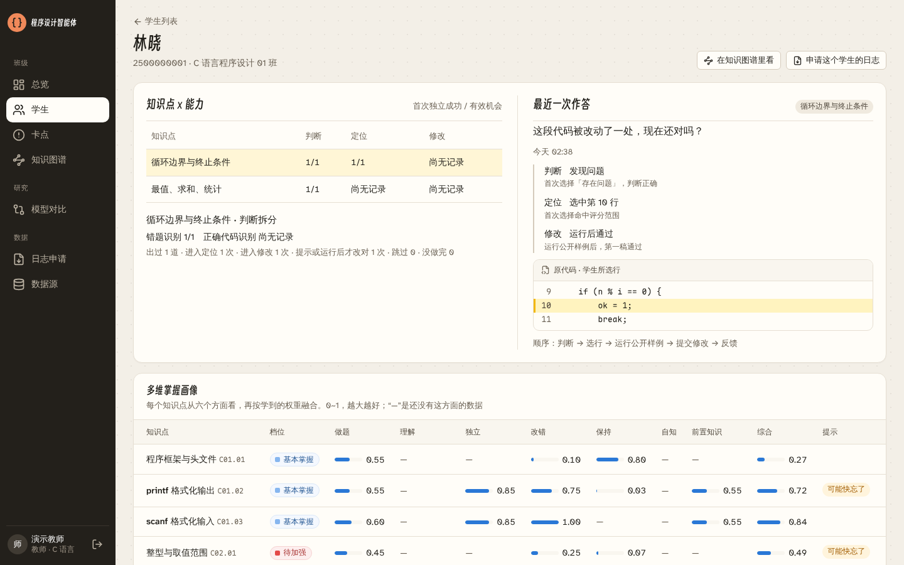
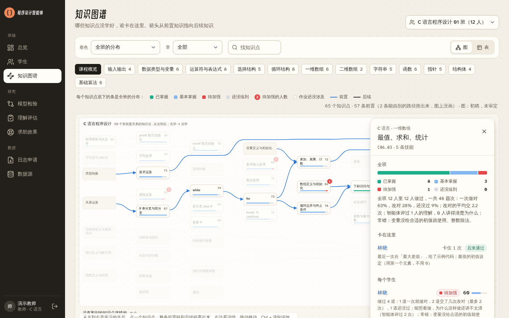
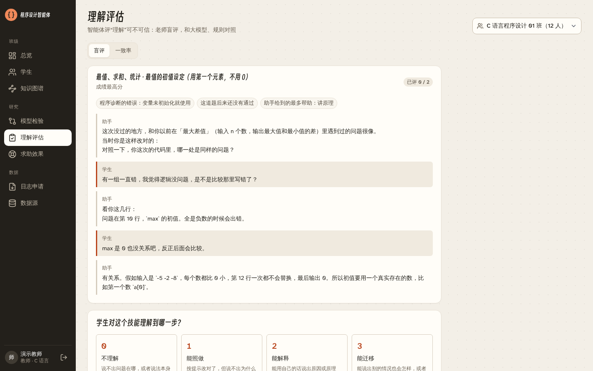

# 教师端结构

教师端分三块：**班级**（上课用）、**研究**（论文用）、**数据**（导出和同步）。每一页只回答一个问题。

## 一页回答一个问题

| 块 | 页面 | 回答什么 | 页面上有什么 |
|---|---|---|---|
| 班级 | 总览 | 这周班里怎么样？先关注谁，课上讲什么？ | 从上到下：三个数（本周交过题、平均几次改对、本周提交）；误区（本周 / 全部两个页签，前 6 条，全部在“误区”页）；要讲的知识点（和误区同宽、两列对齐；待加强、卡住过、没来问的人多的知识点，带最常见的错误）；需要留意的学生（分三类：一直不做题、一直卡在某处、其他，每人附理由）和作业完成情况；两张趋势图 |
| 班级 | 提交记录 | 班里最近交了什么、错在哪？ | 每一次提交，最近的在前；按学生、题目、结果筛；点一条就地展开他的代码（标出程序标的出错行）、标的错误、没过的测试点（输入、期望输出、他的输出，学生端看不到） |
| 班级 | 误区 | 课上要强调哪些错误点？ | 全部误区（本周 / 全部）：一种错误 × 一个技能，几个人、几次提交、还没过的几人、卡住几次、小题里没看出来的几人、出现在哪几道题、谁、他们的说法（智能体评“理解”时看出的错误想法）；可以搜、按知识点看。定义在 `app/misconceptions.py` |
| 班级 | 学生 | 每个学生做得怎么样？ | 学生列表，可以搜、可以按任何一列排序 |
| 班级 | 学生明细 | 这个学生卡在哪，怎么帮？ | 分五个页签，见下面 |
| 班级 | 知识图谱 | 哪些知识点没学好？谁卡在这里？ | 图或表（表能按待加强、卡住、没来问的人数排）。点一个知识点看：全班、卡在这里的学生、没来问的学生、每个学生、小题三维、技能、常见错误、练这个知识点的题、前置和后续 |
| 班级 | 跨课程（只在数据结构） | 要先补哪些 C 语言基础？ | C 基础预警、跨课程联系 |
| 研究 | 模型检验 | 掌握程度怎么算更准？（创新点二） | v1、v2、图模型、多维融合的 Brier 分数，消融，学到的权重；掌握分每周学的参数（这一版的系数和半衰期，和经验值比之后预测的 Brier）；根因推断，前置关系的统计 |
| 研究 | 理解评估 | 智能体评“理解”可不可信？（创新点一） | 大模型和规则的一致率；按事实下调了多少、为什么；各档、各种材料各有多少（盲评不做了） |
| 研究 | 求助效果 | 分级帮助有没有用？谁卡住了又没来问？（创新点三） | 按知识点的卡点结局（第二次自己想起来、卡后通过、之后新题一次通过、没来问）；每次帮助之后（按帮助级别：再交了、下一次就通过、讨论的错误没了、之后通过）；对话行为和做题表现 |
| 数据 | 日志申请 | 导出学生的使用记录 | 带学号和姓名，研究用的几类带指标版本 |
| 数据 | 数据源 | 同步正不正常 | 同步状态 |

## 学生明细的页签

| 页签 | 有什么 |
|---|---|
| 概况 | 几个数（掌握分、已通过、平均几次改对、待加强的知识点、最近提交）；知识点表（档位、掌握分、一句话、提示）。数据结构这边另有“C 语言基础”和准备度 |
| 求助 | 卡点（哪道题、怎么解决的、之后过没过）和最近一次给的示例代码；求助回合；理解评估（附学生原话）；对话行为 |
| 小题和复习 | 判断、定位、修改三维和最近一次作答的依据；小题记录；复习安排 |
| 提交 | 提交记录（测试点、错误标注）；雷同的通过 |
| 模型细节 | 研究用：多维画像的数值、技能的 v2 估计和区间、v1、图模型、根因推断；数据结构的联合状态 |

## 数放在哪

- 上课用的页面只放老师用得上的：档位、掌握分、一句话、谁、哪道题、几次。
- 模型内部的数（估计值、区间、半衰期、v1 和图模型的对照、各维度的数值）、Brier、κ、比例指标，只放在研究页和学生明细的“模型细节”。
- 同一件事只在一个地方细看，别处只给数和链接：
  - 卡点：知识点的卡点在知识图谱的知识点详情里看，一个学生的卡点在学生明细的“求助”里看；
  - 判断、定位、修改：全班的在知识点详情里看，一个学生的在学生明细的“小题和复习”里看；
  - 智能体评估：每一次评的依据在学生明细的“求助”，可不可信在研究的“理解评估”。

## 截图

| 总览 | 学生明细 · 概况 |
|---|---|
|  |  |
| 知识图谱 · 知识点详情 | 知识图谱 · 表 |
|  |  |
| 研究 · 理解评估 | 研究 · 求助效果 |
|  |  |

## 页面多久更新

汇总页不让老师等着重算（`app/web/cache.py`）：数据变了先给上次算好的（标 refreshing），后台算新的，页面过两秒再取；“数据变没变”的定时询问一发现变了，最近半小时看过的页面就在后台先算；取班级列表时先把总览算上。总览里“会做但讲不清”只取做题和理解两维（`profile.explain_gaps`，结果和完整画像一样），不再给每个学生算一遍完整画像。

页面不各自定时刷新。教师端只在一个地方每分钟问一次“数据变没变”（看不见页面时不问，切回标签页马上问），变了打开着的页面才重取；数据没变最多十分钟重取一次（“本周”这类按时间算的数）。切回已经看过、数据没变的页面不再请求。

## 旧地址

`/teacher/stuck`（原来的“卡点”页）跳到知识图谱的表，按卡住的人数排；`/teacher/graph` 跳到模型检验。
