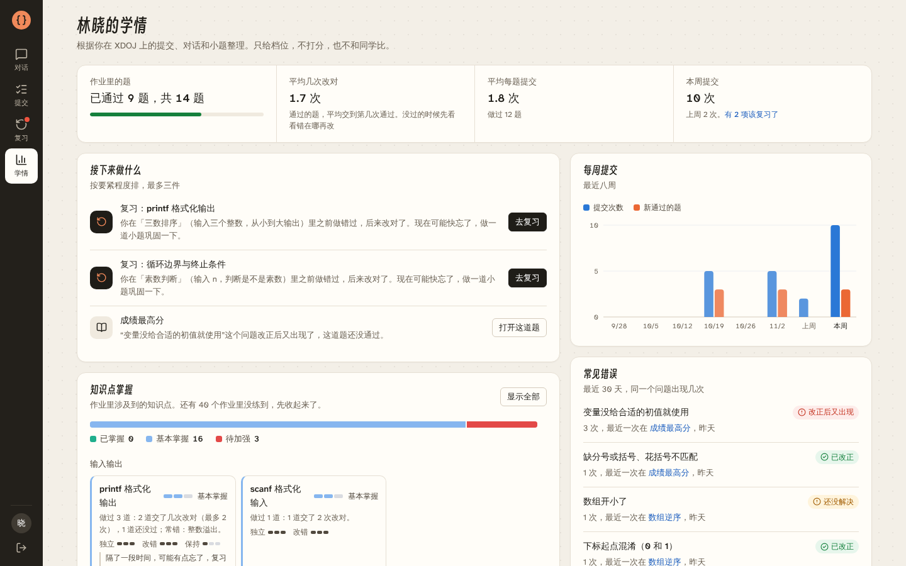
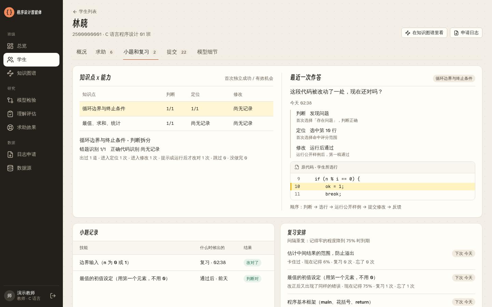

# 界面改造方案的落实

依据：[学生端界面改造方案](design/界面改造方案/界面改造方案.md)（评审稿，基于 `8f30812`，图 1～9 是桌面设计稿）。方案分四批交付，这里记每一批做了什么、和方案不一样的地方、怎么验的。

| 批次 | 状态 |
|---|---|
| ① 导航和历史迁移 | 已做（本文第 1 节） |
| ② 独立作答（复习提升：先判断、再定位、按选择修改） | 已做（本文第 2 节） |
| ③ 学情与论文数据（判断、定位、修改三维） | 已做（本文第 3 节）；授权导出沿用已有的日志申请 |
| ④ 课程资料（教材、课件的可追溯引用） | 等教师上传资料；知识问答已经能在没有资料时上线，资料栏留了位置 |

## 和方案不一样的地方

- **配色。** 方案第 6 节写“延续现有深色窄导航、白色阅读面和黄色选行”，是按 `8f30812` 的样子写的。之后按反馈改成了两套浅色纸面（C 语言暖色、数据结构冷色，见 [首页课程切换与统一登录](首页课程切换与统一登录.md)），这里保留纸面，采用方案里的颜色分工：
  - 黄色 `#FFD54A` 只标“当前操作”：选中的题、选中的问答（左边一道黄条）、输入框上“带着什么一起问”的标签、待做的数字；
  - 已公布的评测结果用绿 `#287455`、砖红 `#9F4835`，一定配文字（对比度在两套纸面上都在 4.8 以上）；
  - 原来的橙色只留在产品标志上，小图标改回中性灰，免得和砖红的“错误”混淆。
- **侧边栏宽度。** 设计稿是带文字的宽导航。学生端仍是 68px 的图标竖条（图标下面一行字），把宽度留给 605px 的右栏。“我的学情”按方案放在左下角。
- **复习提升的版式。** 方案第 4 节是一条阅读轴线、撤下聊天。按用户的要求改成和知识问答一样的“左边列表、右边对话”：左边是今天这道、复习安排、做完的复习题（每道一段对话）；右边是智能体先说为什么复习这里，接着这道小题就在对话里独立作答，做完给反馈，之后在下面的输入框就这道题提问。反馈之前输入框不能用，独立作答的规则不变（`pages/Review.tsx`）。以前那个弹出的“本题答疑”窗口去掉了。
- **作业引导看代码。** 右栏每次提交的“看代码”就在那一行下面展开，再点收起，不再打开占满屏幕的新窗口；“就这一版问”在展开的代码下面（`components/Lists.tsx`）。
- **顶上的面包屑。** 设计稿每页顶上有“学生工作台 / 作业引导 / …”，方案正文没要求，这里没加，页面标题已经说明在哪。

## 1. 导航和历史迁移（第①批）

**三个栏目 + 我的学情。** 侧边栏上面是“知识问答”“作业引导”“复习提升”（带待做数），左下角是“我的学情”。一级导航“提交”撤掉了：
- 看这道题的提交：作业引导的右栏；
- 看别的题：我的学情右上角“全部提交记录”（`/submissions`，地址没变）。

**怎么进、怎么回来**（`frontend/src/lib/memory.ts`）：
- 第一次登录进作业引导；再次登录回到上次的位置；外部链接优先于上次的位置。
- 每个栏目记着自己最近的位置：在某题写了一半，去知识问答查个概念，再点“作业引导”，还是那道题、那次选中的提交、那段没发出去的草稿、原来的滚动位置。
- 记着的题不在作业里了（换班、题被撤），或者问答不在了：退回这个栏目的首页。
- 草稿按账户、课程、对话分开存在本机（键里是哈希，不直接写学号），退出登录时清掉。

**旧链接。**
- `/chat/general`（以前的综合对话）到知识问答的“以前的问答”；
- `/chat/题目` 到 `/homework/题目`，`diff` 等查询参数照带；
- 以前的 `?ask=`（“问问为什么错”自动发问）变成 `?sub=`：只把那次提交带进下一条消息，不替学生发问。

**知识问答**（`pages/Knowledge.tsx`、`chat_topics` 表、迁移 0009）：
- 左边问答记录，可以新建问答。第一条消息发出时才建主题，名字取这一问（最长 16 个汉字宽）。以前的综合对话列在里面，叫“以前的问答”，内容和时间不动。
- 不按题名、贴的代码、最近的提交自动绑到作业题。学生点了输入框上方的“结合当前题：××”才带上作业引导里最近打开的那道题（他选的那次提交，没选就是最近一次），可以去掉。
- 没带题、没贴代码的“为什么……”“怎么……”按概念问题直接答，不反问“是哪道题”。
- 知识问答里不出小题（小题在复习提升里做），以前对话里出过的题照样能看。
- 课程资料栏只在回答引用了资料时出现；现在还没有资料，所以不出现（第④批）。

**作业引导**（`pages/Workbench.tsx`）：
- 左栏“全部作业 → 本次题目”，排序沿用方案的规则（`lib/problems.ts`）：
  - 没通过的按最近提交倒序；
  - 没提交的按题号；
  - 评测中、结果未知的单列；
  - 通过的放最后。
- 返回按钮高 44px，只退左栏，这道题的对话、右栏、草稿都留着。
- 还没选题时可以先写下问题，选了题会带进那道题的输入框（那道题自己没有草稿时）。
- 右栏“本题提交”每一次都直接列出来：第几次、时间、结果文字、测试点方块、几组通过、“看代码”，下面一行写改了什么。最下面“比较最近两次修改”。
- “看代码”里有“就这一版问”，把这次提交带进下一条消息（输入框上方出现“针对第 N 次提交”，可以去掉）。
- 去掉了“问问为什么错”“展开之前提交”两个中间步骤。

**全部提交记录**（`pages/Submissions.tsx`）：
- 从我的学情进来，左上角回到我的学情；
- 最近交过的题在上，作业筛选、看代码、完整对照都保留；
- “就这一版问”回到那道题，带着那次提交。

**检查过的**（演示数据，Chromium 1440×900 和 iPhone 13）：
- 第一次登录落在 `/homework`；
- 先写的草稿进题后还在；
- “就这一版问”出现“针对第 3 次提交”，地址带 `?sub=`；
- 知识问答出现“结合当前题：成绩最高分”；新问答发出后变成 `/ask/t1`，名字是第一个问题；
- 回到作业引导还是同一道题、同一次提交、同一段草稿；
- `/chat/general` 跳到知识问答；全部提交记录、我的学情能打开；
- 手机上底部四个标签，“问答记录”在抽屉里；
- 页面没有脚本错误。

后端测试 `tests/test_knowledge.py`：
- 主题各是各的；不自动绑作业题；选了“结合当前题”才绑；
- 概念问题不反问是哪道题；主题里不插小题；
- 别的学生、另一门课看不到。

## 2. 独立作答（第②批）

**复习提升就是作答的地方**（`pages/Review.tsx`、`components/Attempt.tsx`）：
- 进来就是一道备好的题。后台空闲时给最近来过、有到期复习的学生提前备好（`review.prepare_active`）；没备好就当场出一道（`review.prepare`）。
- 某一项这会儿出不了题，就换下一项；都出不了，退避 5 分钟，页面写“题目正在准备”，好了自己出现。
- 侧边栏的数字只数备好的题；到期几项、今天做完几道在页面上分开写。
- 撤下了原题、聊天和提交侧栏，题干、代码、作答在一条阅读轴线上。
- 中途离开，回来是同一道、同一步。做完给完整反馈，有下一道就“下一题”，没有就回到复习安排。
- 今天没有可做的题：给最近一次的反馈和接下来的安排。

**四步**（`app/quiz.py`，`protocol` 2，迁移 0010）：
- **判断**：“满足要求”“存在问题”两个一样大的按钮，确认前可以改选，确认后锁定。“把握（可选）”放在确认按钮旁边，不再是必选的一整步。代码里没有任何高亮。
- **位置或依据**：学生自己点行号选一行或连续几行（Shift 选一段，键盘 Tab 到行号、回车选），选中的行才变黄。判断有问题的叫“确认位置”，判断满足要求的叫“确认依据”。
  - 只有代码真有错、又判断了有问题，才算这次选行命中没有；选太多行不算命中。
- **修改**（只有判断有问题的才进来）：
  - “运行公开样例”只跑第一组检查数据，不算一次提交；
  - “看提示”一条比一条具体，代码本来就对的题不说破；
  - “提交修改”可以原样提交，接受行为等价的改法；
  - 编译不过、运行环境不可用都不算一次提交。
- **反馈**：判断、位置或依据、修改三句；代码真有错没改对的给出错在哪、可以怎么改。反馈以后才开放“回看相关作业”。

**四种正误组合**：

| 真实情况 | 学生的判断 | 之后 | 反馈里的修改那一句 |
|---|---|---|---|
| 有错 | 存在问题 | 选位置 → 修改 | 第一稿就改对了 / 运行公开样例后，第一稿改对了 / 看了提示后改对 / 第二次改对 / 两次都没改对 |
| 有错 | 满足要求 | 选依据 → 反馈（给出错在哪、怎么改） | 未进入（判断时没发现问题） |
| 正确 | 满足要求 | 选依据 → 反馈 | 本题无须修改 |
| 正确 | 存在问题 | 选位置 → 修改（可以原样提交） | 最后保持原样 / 改了以后结果没变，本来不用改 / 改动后结果不对了 |

**记下什么**：
- 首次判断（`judged_has_bug`、`judge_correct`）、首次选行（`first_lines`、`locate_hit`）、首稿（`first_fix`、`first_fix_pass`、`first_fix_clean`：首稿前没看提示、没运行公开样例）各记一次，不再改；
- 展示、判断、选行、运行公开样例、看提示、每次提交、反馈，按顺序进 `events`；
- `item_version` 是题目内容的哈希。
- 重复确认不重复记，失败时页面上的选择和改好的代码都留着。

**和以前的关系**：
- 结果映射回原来的几种 outcome，掌握程度的算法不变。
- 以前的作答（`protocol` 1：把握 → 判断 → 改）照旧显示、照旧能做完。
- 对话里通过以后出的小题也用新的四步。

**和方案不一样的地方**：方案里“漏判后可以在讲解后练习定位和修改（注明已获反馈）”这一步没做，现在漏判直接给出错在哪和怎么改。

**检查过的**（演示数据，Chromium 1440 和 iPhone 13）：
- 进复习提升直接是一道用他自己“素数判断”代码出的题；
- 选“存在问题”和“一半”，确认判断；点第 10 行变黄，“已选第 10 行”，确认位置；
- 改代码、运行公开样例（“公开样例通过：输入 6，输出 No。”）、提交修改；
- 反馈“你找到并改对了错误”，三句是“首次正确 / 选中第 10 行，正是出错的地方 / 运行公开样例后，第一稿改对了”；
- 做完以后侧边栏数字变成 0；
- 剩下的一项这个环境里出不了题（没有大模型），页面写“题目正在准备”，下面是最近一次反馈和接下来的安排；
- 页面没有脚本错误。

后端测试 `tests/test_independent.py`：
- 第一步不泄题；四种组合；公开样例和提示的记录与标签；
- 重复确认、选行要连续；旧协议照旧；
- 备题不重复，一项出不了换下一项。

## 3. 学情和教师端的三维（第③批）

**怎么算**（`app/diagnosis.py`，每个数都从 `quiz_attempts` 复算）：

| 维度 | 分子 / 分母 |
|---|---|
| 判断 | 首次判断正确 / 提交了首次判断的题数。错题识别、正确代码识别分开 |
| 定位 | 首次选中有效位置 / 真实错题里判断有问题、提交了首次选行的次数 |
| 修改 | 看提示之前交的第一稿通过 / 这种第一稿的次数（dims-2：运行过公开样例的也算，没运行就交的另列） |

- 定位和修改只算独立作答（`protocol` 2）。分母受前面判断的影响，只说明实际进入这一步的次数。
- 另列应答机会、进入定位、进入修改、提示或运行后才改对、跳过、没做完。
- 旧版记录（`protocol` 1）有判断、没有独立选行，标“旧版未测定位”，不拿后来改了哪行去补。
- 掌握程度照旧，三维只用来解释，暂不配权重。

**学生：我的学情**（`pages/Progress.tsx`）：
- 判断、定位、修改不另外列表，放进“知识点掌握”里对应知识点的卡片：“小题：判断 1/1 · 定位 1/1”（没做过的那一步不写），后面一句最近一次怎么样。和方案里的图 8 不一样：用户认为“知识点表现”和“知识点掌握”说的是同一件事，不该分开；“练习题目情况”和作业引导重复，去掉了。
- 只有知识点名称、几比几、文字，没有编码、没有百分数。右上角“全部提交记录”。

**老师：学生明细的“小题和复习”页签**（`pages/teacher/Diagnosis.tsx`；教师端的整体结构见 [教师端结构](教师端结构.md)）：
- 左边“知识点 × 能力”，下面“判断拆分”和各种次数；
- 右边“最近一次作答”：判断、定位、修改三步各一句，原代码里学生首次选的行，动作顺序。

**老师：知识图谱节点详情**：
- 全班“小题：判断、定位、修改”三行；
- 每个学生一行几比几和“作答依据”（到学生明细的“小题和复习”）；
- 节点颜色仍是原来的掌握档位。

**检验**：`tests/test_diagnosis.py` 用已知答案的合成作答回算图 9（判断 3/4、定位 1/2、修改 1/2，错题识别 2/2、正确代码识别 1/2）。六种情形各有正确的标签和分母：

| 情形 | 怎么处理 |
|---|---|
| 未进入 | 有错却判断满足要求，不进定位、修改的分母 |
| 未作答 | 不进判断的分母，记为没做完 |
| 不适用 | 正确代码判断有问题，不进定位、修改 |
| 提示后才改对 | 首稿没过、看提示后改对，单独记 |
| 系统失败 | 运行环境不可用，不算一次提交 |
| 历史缺定位 | 旧版记录 |

**检查过的**（演示数据，Chromium 1440 和 iPhone 13）：
- 林晓的学情最上面两行：循环边界与终止条件 1/1、1/1、尚无记录（他先运行了公开样例才交第一稿，所以修改不进分母）；最值、求和、统计 1/1、尚无记录、尚无记录（旧版记录）。
- 老师的学生明细里最近一次作答是“发现问题 / 选中第 10 行 / 运行后通过”，原代码第 10 行是黄色。
- 页面没有脚本错误。

## 代码着色、首页切换和登录按钮

- **代码着色**（`frontend/src/lib/cSyntax.ts`）：对话里智能体贴的代码、提交的代码、小题的代码和选行区都按 C 语法上色。
  - 关键字紫、类型青、函数名蓝、字符串绿，字符串里的 `%d`、`\n` 琥珀，数字和 `NULL` 锈红，注释灰色斜体。
  - 颜色是 `tokens.css` 的 `--syn-*`，在纸面、标黄的行、删掉的行上对比度都不低于 4.5。
  - 小题的编辑器（CodeMirror）用同一套颜色。只给字上色，不标行，独立作答的规矩不变。
- **首页切换学科一点就动**：
  - 以前用慢起步的缓入缓出曲线，前半秒几乎不动，像是等了一秒才变；现在画布和纸面都用先快后慢的曲线，点下去第一帧就开始。
  - 展开的冷色纸刚好盖住最远的角，切回 C 语言时不会先在屏幕外空转一段。
- **登录按钮**：用这门课的强调色（C 语言锈红、数据结构深蓝），压暗一点。
  - 光标移上去，一团柔光跟着光标走，按钮浮起一点，箭头往前挪。
  - 光标底下文字对比度也不低于 4.5。

## 还没做的

- **第④批课程资料**：要等老师上传讲义、教材、课件。知识问答的资料栏留了位置，没有资料时不出现。
  - 资料上传、按页码或幻灯片序号检索、权限、引用核实都还没做。
- **方案里正式测量题的统一任务**：给每个人同一段含错的新代码，用于全班比较。还没做。
  - 现在的正误分配沿用原来的做法：最近 10 题里正确代码占 40%～50%，具体哪道随机。
