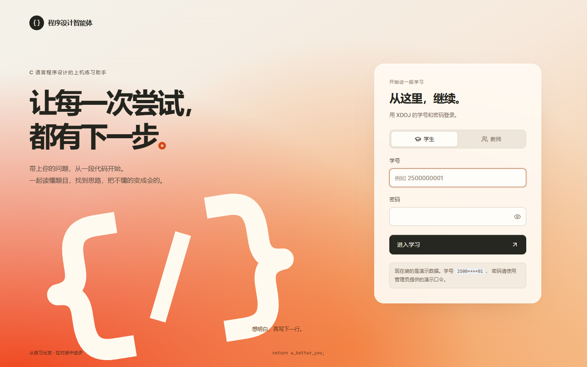

# 首页视觉、右栏与代码上下文修复

2026-11-18。桌面端改动；学生登录后继续直接进入对话，没有重新加入学习仪表盘。

## 首页方向与真实参考

主要依据维护者提供的 Good Times 截图：暖色画布、明显的字号层级、大面积白色图形、克制的操作区。没有识别或声称找到该截图的官方网站，也没有复制其箭头、商标、字标或图片。

本轮实际调用了五个设计 MCP，结果如下。没有购买套餐、生成付费素材或创建公开参考板；A1 本轮只搜索一次。

| 工具 | 本轮搜索与结果 | 设计取舍 |
|---|---|---|
| Inspo | 搜索 warm orange gradient oversized typography software homepage，返回 [Class Creator](https://classcreator.io/) 和 [Fitbod](https://fitbod.me/) 的归档设计信息 | 参考清晰的文字/图形权重，但不沿用设备模型与常规功能区堆叠 |
| Awwwards | 搜索 Good Times，没有匹配案例 | 如实记录未找到，不把其他站点冒充截图出处 |
| Made Good Designs | 返回 [Patchbay hero：UI by Made Good Designs](https://madegooddesigns.com/inspiration/ui/hero-web-minimal-e44b1b829603)，已查看截图；这是该服务的原创 UI 样例，不是真实生产站点 | 对照标题、表单/按钮层级；其蓝色 SaaS 视觉与目标不符，没有移植整套样式 |
| Subframe | 返回 [The Vessel](https://vessel-magazine.no/) 和 [Shopify Design](https://shopify.design/)，已查看首页截图 | 比较前者的暖桃色/深色文字、后者的大标题层级；不复制文章照片或产品拼贴 |
| A1 Gallery | 搜索 good times，返回 [Daylit](https://www.daylit.com/) 和 [ONCE](https://once.com/) 的真实站点记录 | 语义检索结果并非 Good Times，也不是教育产品的精确匹配，不作为主要视觉依据 |

比较后采用“温暖、有力度的学习入口”：米白到暖橙的背景，深色中文大标题，原创 SVG 大括号和斜线，将主视觉与程序设计主题联系起来。表单用安静的浅色表面，保留真实的身份、课程、学号、密码、登录错误和加载状态。未加入虚构的产品统计、下载按钮或无效导航。

## 右栏和桌面布局

- 右侧资料栏从 504px 增加到 605px，约再增加 20%。原始 PDF 按钮仍在右栏题目标题旁。
- 1280–1439px 的窗口把题目列表设为 240px，保留对话空间；题目和作业菜单仍可内部滚动。
- 使用对话容器自身的宽度控制标题与评测结果换行，避免加宽右栏后把题目标题挤没。
- 未开展手机端视觉重做。

## 学生代码引用

- 模型引用和模板引用统一通过程序补上下文：原选中范围前后各补两行，尽量提供至少五行、最多八行；短程序只显示实际存在的行。
- 不丢弃模型已经选择的行，不生成或改写学生源码。保留真实行号，问题行单独高亮，标题同步显示新的行号范围。
- 已有旧对话的一两行引用，在能够核对当时工作流记录、原提交或原粘贴消息时也会补齐。缺少来源、原文字不符、其他学生、其他课程时保持历史引用，不拿最新提交补旧代码。
- 旧记录只在返回视图中补齐，不批量修改数据库历史，也不把内部取证字段返回给学生。

## PDF 样例分段

前后端使用相同的标题规则和一套共享回归样例，覆盖输入/输出示例编号、汉字间空格、零宽字符、不换行空格、全角编号、不同冒号、Markdown 标记和 PDF 特殊换行。识别只针对标题；样例正文的全角字符、缩进和内容不会整体归一化。

后端的模型整理检查也采用同样边界，防止修改、交换或吞掉公开样例。全角标题编号改为半角时，不再误判为模型编造数字。前端即时解析已有题面，无需为所有旧题重复调用模型。

截图中可见的普通“输出示例 1”字符串原本就能通过旧规则；本机没有取得该条线上题面的原始字符。因此本轮验证的是截图文本及上述明确的排版变体，不声称已经确认那条线上数据的具体隐藏字符。原始 PDF 仍可用于核对，未进行 OCR，也未请求真实学生数据。

## 验证

- 前端 9 项测试、TypeScript 检查和生产构建通过，提交对应 frontend/dist。
- Windows Edge 在 1440×900、1280×900 验证登录表单完整显示、身份切换、密码显示/隐藏、登录请求、禁用/错误状态和无页面脚本错误。
- 在 1440×1000、1280×1000 验证 605px 右栏、题目标题不被挤没、对话区不横向溢出、PDF 按钮打开、特殊空格样例分离、长题目/作业列表滚动、直接对话与主动复习；六组检查通过。
- 后端完整测试 208 项通过，覆盖引用的原始行号、首尾边界、短程序、旧引用确切来源、所有权和课程核对。本机对 Linux resource 模块仅做测试进程导入替身，20 项 gcc/沙箱测试跳过。共享分段样例放在 backend/tests/fixtures，后端镜像只复制 backend 目录也能读取回归数据。
- 浏览器和后端使用合成数据及模型替身。本轮没有连接虚拟机、调用真实 DeepSeek、验证 Docker 沙箱或重新同步 XDOJ；部署后的视觉与模型效果仍需运行新版本确认。

本机浏览器记录位于工作区 outputs/warm-login 和 outputs/chat-review-update；仓库截图使用合成与打码数据。
