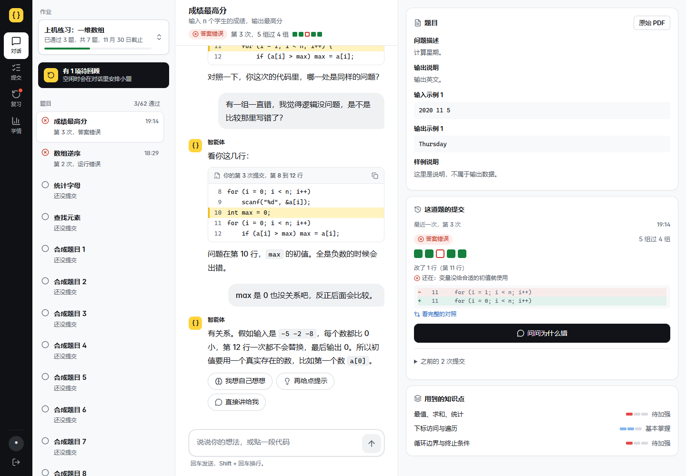
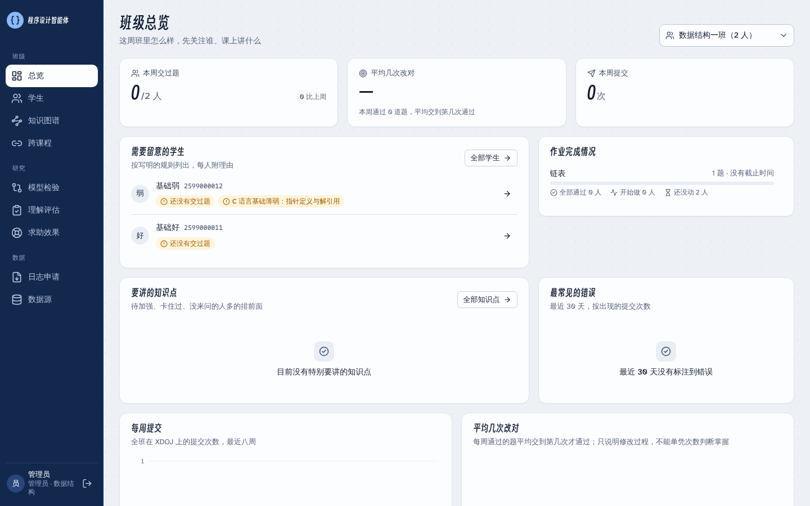
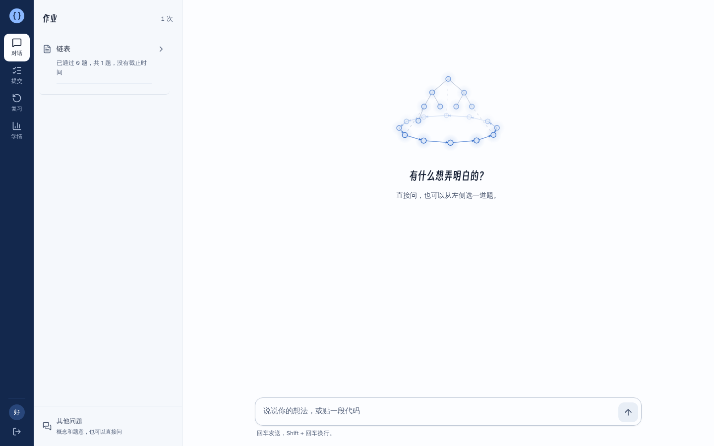
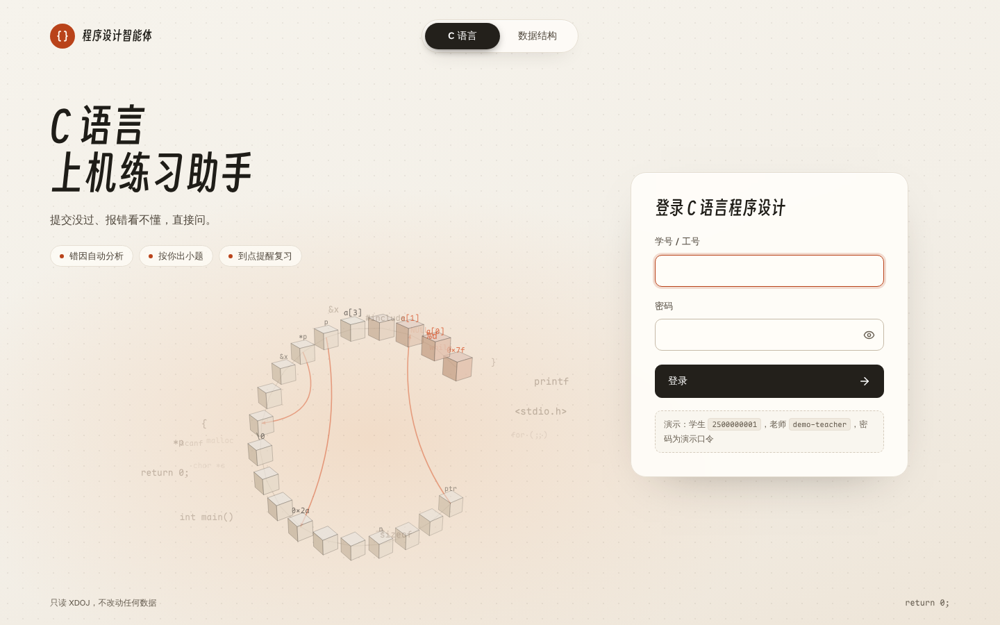

# 首页：课程切换、立体场景、统一登录入口

2026-11-18。改的是登录首页（`frontend/src/pages/Login.tsx`、`components/CourseScene.tsx`、`components/CourseSwitch.tsx`、`styles/login.css`）、登录接口（`backend/app/web/auth.py`、`teacher.py`），以及第二轮的全站配色和字体（`styles/tokens.css`、`styles/type.css`、`main.tsx`）。

同一天做了两轮。第二轮按反馈改了三处：深蓝的数据结构页和暖色的 C 语言页色差太大；字体要用 AI 不常用的；首页要和登录以后的页面协调（里面也太单调）；登录框标题下面的说明太啰嗦，删掉。下面写的是第二轮以后的样子，第一轮和它不一样的地方单独标出来。

## 要解决什么

1. 首页要有 C 语言和数据结构的切换，两个选项一直都在。两门课是两台 XDOJ，账号体系不一样，所以是“首页切换”，选哪门就登录哪门。切换是滑动开关。
2. 原来的主视觉（黄调大括号）不像 C 语言，也不立体。切到数据结构时，背景要环形地转进来深蓝色的数据结构图案。
3. 优秀网站首页的那种跟着光标的轻微动效。
4. 原来的文案奇怪（“从这里，继续。”“看见每一步成长。”“开始这一段学习”“想明白，再写下一行。”“return a_better_you;”），而且学生、教师分两个标签，其实本来就是一个登录入口：输入学号或工号。
5. 数据结构的 XDOJ 地址以后再给，先把逻辑留好。

## 参考

这次会话里没有设计类 MCP（Inspo、Awwwards、Made Good Designs、Subframe、A1 Gallery 都没有接上），网络代理也不让打开这些站点本身，所以下面的参考**只看了搜索结果里的摘要和说明文字，没有打开页面核对**。只借鉴结构和交互思路，没有照搬任何素材、配色和品牌元素。

| 参考 | 看到了什么（摘要） | 借鉴了什么 | 没借鉴什么 |
|---|---|---|---|
| [RING（Framer 组件）](https://www.framer.com/marketplace/components/ring/) | 用 CSS 3D 把一组元素排成环，持续转动，光标移动时整个环沿 X、Y 轴倾斜 | 整个场景跟着光标倾斜（左右 ±0.32、上下 ±0.2 弧度，慢慢跟上） | 不停地转：这里平时只轻轻摆动，转只发生在切换课程的那一下 |
| [Orbit Hero（Framer 组件）](https://www.framer.com/marketplace/components/orbit-hero/) | 一圈图片在标题后面绕着转，空闲时自己漂移 | 主视觉放在标题后面、偏下，空闲时很慢地摆动、记号上下浮动 | 用图片排环：这里用的是代码和数据结构本身 |
| [3D Scroll Cylinder（Framer 组件）](https://www.framer.com/marketplace/components/3d-scroll-cylinder/) | 内容排在圆柱面上，滚动时转过去 | “转过去换一面”的切换方式：C 语言的环绕竖轴转半圈，转到背面时变成数据结构 | 跟着滚动转 |
| [Building an Interactive 3D Hero Animation](https://matsimon.pages.dev/blog/building-an-interactive-3d-hero-animation) | 粒子组成的主视觉，光标附近的粒子被推开或吸过去 | 光标附近的格子、节点亮起来，被轻轻吸过去一点（最多约 8%） | WebGL、大量粒子：这里一共几十个元素，Canvas 2D 就够 |
| [Awwwards：Hero Section Animation](https://www.awwwards.com/inspiration/hero-section-animation-bolt-designs) | 首屏动画的一组案例 | 动效只放在首屏、幅度小、不挡操作 | — |
| [VisuAlgo](https://visualgo.net/) | 数据结构和算法的可视化教学网站 | 数据结构那边画真实的结构：循环链表带 `next` 箭头、一棵二叉排序树（8、3、12、1、5、9、15、0）、几条图的边 | 它的配色和界面 |

## 做法

**C 语言：开口的环。** 字母 C 本身就是一个开口的环，所以用 20 个内存单元（真正的立方体：8 个顶点做透视投影，按法线挑看得见的面，每个格子自己斜着摆，露出顶面和侧面）沿 40°～320° 排成缺口朝右的环。格子上有 `a[0]`、`*p`、`&x`、`'C'`、`\0`、`0x2a` 这类标签，相邻的格子连着（连续的内存），三条橙色的弧线是指针。周围前后几层浮着 C 的记号（`#include`、`<stdio.h>`、`printf`、`scanf`、`malloc`、`->`、`return 0;`……），越远越淡。纸面暖色，和以前的首页一脉相承。

**数据结构：闭合的环转进来。** 切换时整个场景绕竖轴转半圈（1.6 秒，先慢后快再慢），中途前后拉开一点更有立体感；格子交叉淡出成发光的节点，合成从上往下看的轨道：12 个节点的循环链表（最前面的标 `head`，箭头是 `next`），环心上方立着一棵二叉树，几条虚线是图的边，记号换成 `push`、`pop`、`queue`、`DFS`、`BFS`、`O(log n)`……同时冷色的纸从环心以圆形展开（`clip-path: circle()`），和环转过来同步。图案是深蓝的，底色仍是浅色（第一轮是整页深蓝底、青色节点，和暖色的 C 语言页色差太大，第二轮改掉）。

**光标。** 整个场景朝光标轻微倾斜；离光标约 130px 以内的格子、节点、记号亮起来（橙色或深蓝），平时不显示的标签也显示出来。

**开关。** 顶栏正中一个药丸形的单选组（`role="radiogroup"`），滑块用 `transform` 滑过去，颜色跟着课程变；可以 Tab 进来，左右方向键、Home、End 切换。记住上次选的课（浏览器本地存储，存不了就默认 C 语言）。

**统一登录入口。** 一个“学号 / 工号”输入框加密码。后端：
- 用户表里有这个学号的学生：照旧去他班级那台 XDOJ 核对密码，不保存；
- 演示教师、管理员：用演示口令；
- 都不是：去**这门课**的 XDOJ 试登一次（`teacher.verify_on`）。XDOJ 说是教师（`userType` 1）就登记数据源、进教师端（`teacher.finish_login`，和原来的教师登录同一段代码，密码加密保存给后台同步用）；XDOJ 说是学生，就是名单还没同步到，马上自动同步一次并提示一两分钟后再试；密码不对就说不对；XDOJ 连不上就说连不上。
- 原来的 `/api/teacher/login` 保留（脚本和旧页面用），页面上不再调用。

**数据结构没接入时。** `/api/auth/info` 多了 `allCourses`：两门课一直都在，`available` 表示能不能登录（有地址的 XDOJ，或者库里已经有这门课的班级）。`.env` 的 `XDOJ_DS_URL` 填上以后自动变成能登录，不用改代码。没接入时首页照样能切过去看，表单说明“数据结构的 XDOJ 还没接入”，输入框和按钮不能用。

**文案。** 只留必要的：标题、一句话、三个要点、登录框，不写操作说明。

| 位置 | 第一轮以前 | 现在 |
|---|---|---|
| 标题 | 让每一次尝试，都有下一步。 | C 语言 / 上机练习助手（数据结构 / 上机练习助手） |
| 说明 | 带上你的问题，从一段代码开始。一起读懂题目，找到思路，把不懂的变成会的。 | 提交没过、报错看不懂，直接问。（链表、栈、树、图，卡住了直接问。） |
| 要点 | 无 | 错因自动分析 · 按你出小题 · 到点提醒复习（数据结构第二条是“补 C 语言基础”） |
| 表单标题 | 开始这一段学习 / 从这里，继续。 / 看见每一步成长。 | 登录 C 语言程序设计（登录数据结构） |
| 表单说明 | 用 XDOJ 的学号和密码登录。 | 删掉（第一轮写过“学生填学号，老师填工号，密码和 C 语言 XDOJ 的一样。”，太啰嗦） |
| 身份 | 学生 / 教师 两个标签 | 没有了，一个入口 |
| 按钮 | 进入学习 / 进入教师工作台 | 登录 |
| 演示提示 | 现在装的是演示数据。……密码请使用管理员提供的演示口令。 | 演示：学生 2500000001，老师 demo-teacher，密码为演示口令 |
| 数据结构没接入 | — | 数据结构的 XDOJ 尚未接入 |
| 底部 | 从练习出发 · 在对话中进步 | 只读 XDOJ，不改动任何数据 |

## 第二轮：配色、字体、和登录以后的页面统一

**两套纸面。** 全站只有浅色。C 语言是暖色的纸（底 `#f3efe7`、卡片 `#fffdf8`、侧边栏 `#ebe4d6`、强调色橙 `#b9431a`），数据结构是冷色的纸（底 `#edf1f6`、卡片 `#fcfdff`、侧边栏 `#e1e8f1`、强调色深蓝 `#2160c4`）。只换底色、文字、线、侧边栏和强调色；通过/未通过、掌握档位、图表的颜色两门课一样（以前用 dataviz 校验脚本核对过色弱下也分得开，不动）。切换课程时只是纸的冷暖变了，色差小；首页的开关滑块、登录按钮用课程的深色（`--ink-block`：墨色 `#23201b`、深蓝 `#13284d`）。

**侧边栏（2026-11-21 起）。** 以前是墨色和深蓝的深色侧栏，改成比页面深一档的同一种纸（从五套候选里选的“纸色侧栏”）：选中项是卡片色的一块、细描边、图标用强调色，标志是强调色的圆。手机上教师端的顶栏和导航抽屉也是这个颜色。流程图的标题和序号、复习提醒的图标这些深色块不跟着侧栏变，用 `--ink-block`。

令牌在 `tokens.css`：`<html data-course="C">` 用暖色，`data-course="D"` 用冷色。登录页跟着课程开关设，登录以后跟着这次登录的课程（`App.tsx`）。以前写死在样式里的冷灰色（侧边栏分隔线、行悬停、行号、骨架屏等）都换成了令牌。

**对比度（WCAG）。** 正文 16.6:1；次要文字在卡片上 8.7（C）/ 8.1（数据结构），在底色上 7.7 / 7.3；最弱的说明文字在卡片上 6.2 / 5.9，在底色上 5.5 / 5.3；侧边栏文字 7.8 / 7.7、分组小标题 4.6 / 4.9；强调色当文字用时在底色上 4.7 / 5.2。强调色在深色底上当图标用对比不够，深色底（复习提醒、墨色按钮）上另用亮一些的 `--brand-on-dark`（`#f0895a` / `#8ab8ff`，6.5 / 7.2）。

**字体。** 不用 Inter、系统默认这类 AI 生成页面最常见的组合：

| 用在哪 | 字体 | 为什么 | 许可、出处 |
|---|---|---|---|
| 标题、品牌名、指标的大数字、卡片标题 | 得意黑 Smiley Sans | 窄、斜、有性格的中文标题字体，网页上不常见；只有一种粗细，本身就粗，不再加粗 | SIL OFL 1.1，[atelierAnchor](https://atelier-anchor.com)；网页用的拆分版本来自[中文网字计划](https://chinese-font.netlify.app)（`@chinese-fonts/dyh`，按字拆成 64 个小文件，一共 1.7 MB，浏览器只下载页面上用到的字） |
| 西文字母和数字 | Atkinson Hyperlegible Next | 为低视力读者设计，0/O、1/l/I 分得很清楚，学号、次数、测试点编号不会看错 | SIL OFL 1.1，[googlefonts/atkinson-hyperlegible-next](https://github.com/googlefonts/atkinson-hyperlegible-next)，[Fontsource](https://fontsource.org/fonts/atkinson-hyperlegible-next) |
| 代码 | Maple Mono | 圆润、易读的等宽字体；代码里关掉连字，`<=`、`!=` 按原样显示 | SIL OFL 1.1，[subframe7536/maple-font](https://github.com/subframe7536/maple-font)，[Fontsource](https://fontsource.org/fonts/maple-mono) |
| 中文正文 | 系统字体（苹方、微软雅黑、思源黑体） | 正文、表格要密而清楚；整套中文正文字体太大，不值得 | — |

字体都跟着前端一起打包（`main.tsx` 引入，`npm` 包里的文件），服务器不连外网也能用；不内联进 CSS（`vite.config.ts`）。许可全文在 `frontend/FONT-LICENSES.txt`。原来的 Inter 字体文件删了。

**登录以后不单调。**
- 页面底色上一层很淡的点阵，像方格本（卡片、对话区是实底，盖住点阵）；
- 页面标题、卡片标题、指标的大数字、对话标题用得意黑；
- 对话空着的时候，显示首页那个环的小图（C 语言是内存格子围成的 C，数据结构是链表和树），跟着光标轻轻转（`CourseScene` 的 `mini`，没有浮动的记号和标签）；
- 产品标志、指标的小图标、要点前的小圆点用课程的强调色；以前的黄色标志只保留在代码里被指出的那一行（黄色的荧光笔）。

| 教师总览，C 语言 | 教师总览，数据结构 |
|---|---|
|  |  |

## 布局

- 宽屏（≥1024）：顶栏是品牌和课程开关；左边标题、说明、三个要点，环在左栏下半部分（环心在页面的 37%、70%）；右边登录框。
- 窄屏（<1024）：顶栏、标题和说明，环缩小放在标题右边（顶上 340px 那一条里，环心 76%、170px），下面是登录框；三个要点和底部的代码不显示。390 宽时品牌名也不显示，只留图标。
- 画布 `aria-hidden`，不接收鼠标事件；标签页切到后台时停止绘制；设备像素比最多按 2 算。

| C 语言，390 | 数据结构，390 |
|---|---|
|  |  |

## 检查过什么

在这个开发环境里用 Chromium（Playwright）对着演示数据检查：

- 1440×900、1280×800、768×1024、iPhone 13：两门课都截图看过，标题、说明、环、登录框不互相压住；窄屏不横向滚动。
- 切换：点“数据结构”，0.7 秒时截图能看到冷色的纸从环心展开、环正在转；2 秒后是完整的数据结构场景。
- 第二轮：学生端对话、学情、复习、提交，教师端总览、学生、知识图谱，C 语言和数据结构各截图看过（1440 和 390）；得意黑、Atkinson Hyperlegible Next、Maple Mono 都加载出来了；页面没有脚本错误。`docs/design/screenshots` 里其余的截图是第一轮以前的配色，没有逐张重截。
- 光标：移到右上方时场景朝那边倾斜；移到环上时附近的格子变橙、标签出现。
- 键盘：Tab 到开关上有清楚的焦点框；在“数据结构”上按左方向键回到“C 语言”。
- 减少动态效果（`prefers-reduced-motion: reduce`）：点“数据结构”150 毫秒后截图已经是完整的数据结构场景，没有转动和展开；平时不摆动、不跟光标。
- 数据结构没接入：输入框、密码框、登录按钮都不能用，提示写着还没接入。
- 登录：演示学生密码错时显示“学号或密码不对”；密码对时进入对话页；`demo-teacher` 在同一个入口登录后进入教师端。
- 页面没有脚本错误（控制台只有没登录时 `/api/auth/me` 的 401，这是正常的）。

后端测试：老师用工号在统一入口登录（`test_one_entry_for_teachers_and_students`）、两门课一直列出且数据结构接入后变成能登录（`test_all_courses_always_listed`）、名单外的学号只有 XDOJ 确认是学生时才说“名单还没同步”、测试一律不连真实 XDOJ（`conftest.py` 的 `_no_real_xdoj`）。

没有做的：没有在 Safari、Firefox 和真机上看；没有连真实的 XDOJ 试统一入口（这个环境连不上那台服务器）；数据结构真正接入后的样子要等地址给了再看一次。
