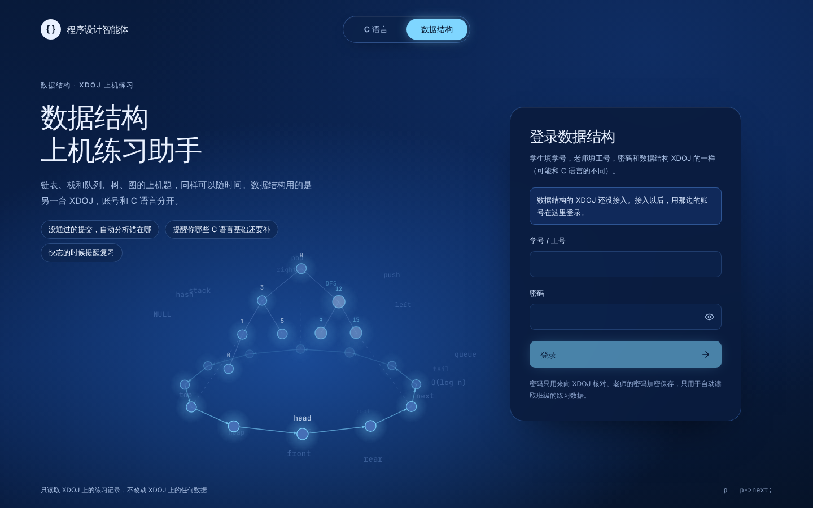
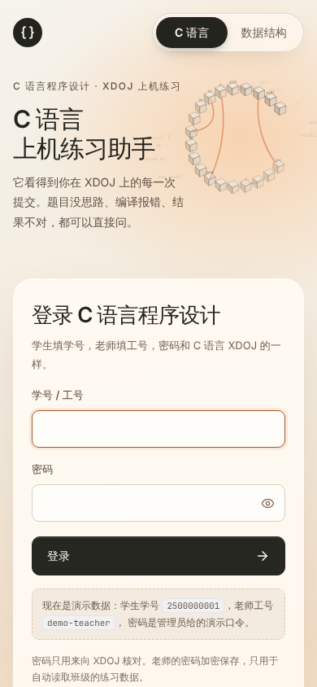
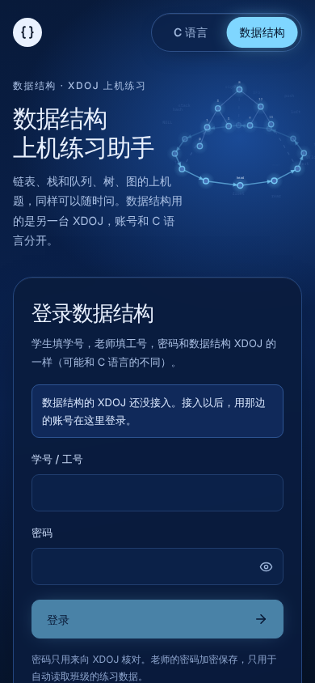

# 首页：课程切换、立体场景、统一登录入口

2026-11-18。改的是登录首页（`frontend/src/pages/Login.tsx`、`components/CourseScene.tsx`、`components/CourseSwitch.tsx`、`styles/login.css`）和登录接口（`backend/app/web/auth.py`、`teacher.py`）。

## 要解决什么

1. 首页要有 C 语言和数据结构的切换，两个选项一直都在。两门课是两台 XDOJ，账号体系不一样，所以是“首页切换”，选哪门就登录哪门。切换是滑动开关。
2. 原来的主视觉（黄调大括号）不像 C 语言，也不立体。切到数据结构时，背景要环形地转进来深蓝色的数据结构图案。
3. 优秀网站首页的那种跟着光标的轻微动效。
4. 原来的文案奇怪（“从这里，继续。”“看见每一步成长。”“开始这一段学习”“想明白，再写下一行。”“return a_better_you;”），而且学生、教师分两个标签，其实本来就是一个登录入口：输入学号或工号。
5. 数据结构的 XDOJ 地址以后再给，先把逻辑留好。

## 参考

这次会话里没有设计类 MCP（Inspo、Awwwards、Made Good Designs、Subframe、A1 Gallery 都没有接上），网络代理也不让打开这些站点本身，所以下面的参考**只看了搜索结果里的摘要和说明文字，没有打开页面核对**。只借鉴结构和交互思路，没有照搬任何素材、配色和品牌元素。

| 参考 | 看到了什么（摘要） | 借鉴了什么 | 没借鉴什么 |
|---|---|---|---|
| [RING（Framer 组件）](https://www.framer.com/marketplace/components/ring/) | 用 CSS 3D 把一组元素排成环，持续转动，光标移动时整个环沿 X、Y 轴倾斜 | 整个场景跟着光标倾斜（左右 ±0.32、上下 ±0.2 弧度，慢慢跟上） | 不停地转：这里平时只轻轻摆动，转只发生在切换课程的那一下 |
| [Orbit Hero（Framer 组件）](https://www.framer.com/marketplace/components/orbit-hero/) | 一圈图片在标题后面绕着转，空闲时自己漂移 | 主视觉放在标题后面、偏下，空闲时很慢地摆动、记号上下浮动 | 用图片排环：这里用的是代码和数据结构本身 |
| [3D Scroll Cylinder（Framer 组件）](https://www.framer.com/marketplace/components/3d-scroll-cylinder/) | 内容排在圆柱面上，滚动时转过去 | “转过去换一面”的切换方式：C 语言的环绕竖轴转半圈，转到背面时变成数据结构 | 跟着滚动转 |
| [Building an Interactive 3D Hero Animation](https://matsimon.pages.dev/blog/building-an-interactive-3d-hero-animation) | 粒子组成的主视觉，光标附近的粒子被推开或吸过去 | 光标附近的格子、节点亮起来，被轻轻吸过去一点（最多约 8%） | WebGL、大量粒子：这里一共几十个元素，Canvas 2D 就够 |
| [Awwwards：Hero Section Animation](https://www.awwwards.com/inspiration/hero-section-animation-bolt-designs) | 首屏动画的一组案例 | 动效只放在首屏、幅度小、不挡操作 | — |
| [VisuAlgo](https://visualgo.net/) | 数据结构和算法的可视化教学网站 | 数据结构那边画真实的结构：循环链表带 `next` 箭头、一棵二叉排序树（8、3、12、1、5、9、15、0）、几条图的边 | 它的配色和界面 |

## 做法

**C 语言：开口的环。** 字母 C 本身就是一个开口的环，所以用 20 个内存单元（真正的立方体：8 个顶点做透视投影，按法线挑看得见的面，每个格子自己斜着摆，露出顶面和侧面）沿 40°～320° 排成缺口朝右的环。格子上有 `a[0]`、`*p`、`&x`、`'C'`、`\0`、`0x2a` 这类标签，相邻的格子连着（连续的内存），三条橙色的弧线是指针。周围前后几层浮着 C 的记号（`#include`、`<stdio.h>`、`printf`、`scanf`、`malloc`、`->`、`return 0;`……），越远越淡。纸面暖色，和以前的首页一脉相承。

**数据结构：闭合的环转进来。** 切换时整个场景绕竖轴转半圈（1.6 秒，先慢后快再慢），中途前后拉开一点更有立体感；格子交叉淡出成发光的节点，合成从上往下看的轨道：12 个节点的循环链表（最前面的标 `head`，箭头是 `next`），环心上方立着一棵二叉树，几条虚线是图的边，记号换成 `push`、`pop`、`queue`、`DFS`、`BFS`、`O(log n)`……同时深蓝色的背景从环心以圆形展开（`clip-path: circle()`），和环转过来同步。

**光标。** 整个场景朝光标轻微倾斜；离光标约 130px 以内的格子、节点、记号亮起来（橙色或青色），平时不显示的标签也显示出来。

**开关。** 顶栏正中一个药丸形的单选组（`role="radiogroup"`），滑块用 `transform` 滑过去，颜色跟着课程变；可以 Tab 进来，左右方向键、Home、End 切换。记住上次选的课（浏览器本地存储，存不了就默认 C 语言）。

**统一登录入口。** 一个“学号 / 工号”输入框加密码。后端：
- 用户表里有这个学号的学生：照旧去他班级那台 XDOJ 核对密码，不保存；
- 演示教师、管理员：用演示口令；
- 都不是：去**这门课**的 XDOJ 试登一次（`teacher.verify_on`）。XDOJ 说是教师（`userType` 1）就登记数据源、进教师端（`teacher.finish_login`，和原来的教师登录同一段代码，密码加密保存给后台同步用）；XDOJ 说是学生，就是名单还没同步到，马上自动同步一次并提示一两分钟后再试；密码不对就说不对；XDOJ 连不上就说连不上。
- 原来的 `/api/teacher/login` 保留（脚本和旧页面用），页面上不再调用。

**数据结构没接入时。** `/api/auth/info` 多了 `allCourses`：两门课一直都在，`available` 表示能不能登录（有地址的 XDOJ，或者库里已经有这门课的班级）。`.env` 的 `XDOJ_DS_URL` 填上以后自动变成能登录，不用改代码。没接入时首页照样能切过去看，表单说明“数据结构的 XDOJ 还没接入”，输入框和按钮不能用。

**文案。** 都改成说明这是什么、能做什么：

| 位置 | 以前 | 现在 |
|---|---|---|
| 标题 | 让每一次尝试，都有下一步。 | C 语言 / 上机练习助手（数据结构：数据结构 / 上机练习助手） |
| 说明 | 带上你的问题，从一段代码开始。一起读懂题目，找到思路，把不懂的变成会的。 | 它看得到你在 XDOJ 上的每一次提交。题目没思路、编译报错、结果不对，都可以直接问。 |
| 三个要点 | （无） | 没通过的提交，自动分析错在哪；按你自己的情况出代码小题；快忘的时候提醒复习（数据结构：第二条是“提醒你哪些 C 语言基础还要补”） |
| 表单标题 | 开始这一段学习 / 从这里，继续。 / 看见每一步成长。 | 登录 C 语言程序设计（登录数据结构） |
| 表单说明 | 用 XDOJ 的学号和密码登录。 | 学生填学号，老师填工号，密码和 C 语言 XDOJ 的一样。 |
| 身份 | 学生 / 教师 两个标签 | 没有了，一个入口 |
| 按钮 | 进入学习 / 进入教师工作台 | 登录 |
| 新加 | — | 密码只用来向 XDOJ 核对。老师的密码加密保存，只用于自动读取班级的练习数据。 |
| 底部 | 从练习出发 · 在对话中进步 | 只读取 XDOJ 上的练习记录，不改动 XDOJ 上的任何数据 |

## 布局

- 宽屏（≥1024）：顶栏是品牌和课程开关；左边标题、说明、三个要点，环在左栏下半部分（环心在页面的 37%、70%）；右边登录框。
- 窄屏（<1024）：顶栏、标题和说明，环缩小放在标题右边（顶上 340px 那一条里，环心 76%、170px），下面是登录框；三个要点和底部的代码不显示。390 宽时品牌名也不显示，只留图标。
- 画布 `aria-hidden`，不接收鼠标事件；标签页切到后台时停止绘制；设备像素比最多按 2 算。

| C 语言，390 | 数据结构，390 |
|---|---|
|  |  |

## 检查过什么

在这个开发环境里用 Chromium（Playwright）对着演示数据检查：

- 1440×900、1280×800、768×1024、iPhone 13：两门课都截图看过，标题、说明、环、登录框不互相压住；窄屏不横向滚动。
- 切换：点“数据结构”，0.7 秒时截图能看到深蓝从环心展开、环正在转；2 秒后是完整的数据结构场景。
- 光标：移到右上方时场景朝那边倾斜；移到环上时附近的格子变橙、标签出现。
- 键盘：Tab 到开关上有清楚的焦点框；在“数据结构”上按左方向键回到“C 语言”。
- 减少动态效果（`prefers-reduced-motion: reduce`）：点“数据结构”150 毫秒后截图已经是完整的数据结构场景，没有转动和展开；平时不摆动、不跟光标。
- 数据结构没接入：输入框、密码框、登录按钮都不能用，提示写着还没接入。
- 登录：演示学生密码错时显示“学号或密码不对”；密码对时进入对话页；`demo-teacher` 在同一个入口登录后进入教师端。
- 页面没有脚本错误（控制台只有没登录时 `/api/auth/me` 的 401，这是正常的）。

后端测试：老师用工号在统一入口登录（`test_one_entry_for_teachers_and_students`）、两门课一直列出且数据结构接入后变成能登录（`test_all_courses_always_listed`）、名单外的学号只有 XDOJ 确认是学生时才说“名单还没同步”、测试一律不连真实 XDOJ（`conftest.py` 的 `_no_real_xdoj`）。

没有做的：没有在 Safari、Firefox 和真机上看；没有连真实的 XDOJ 试统一入口（这个环境连不上那台服务器）；数据结构真正接入后的样子要等地址给了再看一次。
